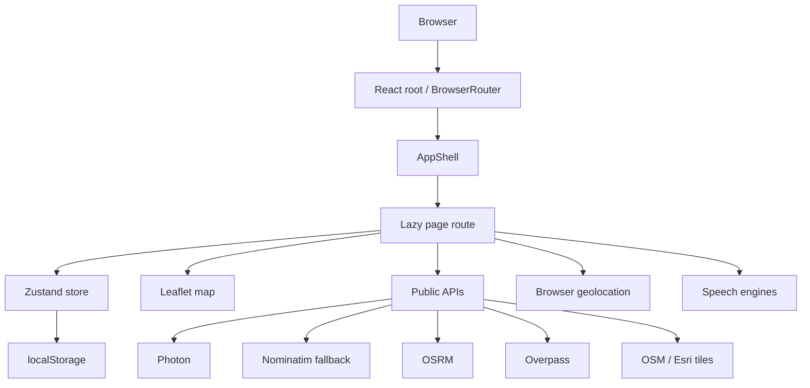

# EcoDrive Route AI

> A client-side route-planning and eco-driving dashboard that compares routed journeys using modelled energy, cost and CO₂ estimates for a selected vehicle.

[](https://react.dev/)
[](https://vite.dev/)
[](https://www.typescriptlang.org/)
[](https://developer.mozilla.org/en-US/docs/Web/Progressive_web_apps)

**Live website:** [ecodriverouteai-druo.vercel.app](https://ecodriverouteai-druo.vercel.app/)

This document is deliberately implementation-led. It describes the application that exists in the repository, not a product plan. Values produced by the energy and emissions model are estimates; GPS tracks are browser measurements after permission is granted; map, geocoding, routing and POI information depends on public external services.

---

# PART I — БЪЛГАРСКА ДОКУМЕНТАЦИЯ

## Съдържание

- [1. Резюме и граници на проекта](#bg-1-резюме-и-граници-на-проекта)
- [2. Какво е реализирано](#bg-2-какво-е-реализирано)
- [3. Визуална идентичност и дизайн система](#bg-3-визуална-идентичност-и-дизайн-система)
- [4. Архитектура и маршрути](#bg-4-архитектура-и-маршрути)
- [5. Страници и потребителски интерфейс](#bg-5-страници-и-потребителски-интерфейс)
- [6. Планиране на маршрут](#bg-6-планиране-на-маршрут)
- [7. GPS, навигация и пренасочване](#bg-7-gps-навигация-и-пренасочване)
- [8. Виртуална симулация на маршрут](#bg-8-виртуална-симулация-на-маршрут)
- [9. Карти и точки от интерес](#bg-9-карти-и-точки-от-интерес)
- [10. Гараж и модели на автомобили](#bg-10-гараж-и-модели-на-автомобили)
- [11. Екологични изчисления](#bg-11-екологични-изчисления)
- [12. Анализи, история, въздействие и Eco Coach](#bg-12-анализи-история-въздействие-и-eco-coach)
- [13. Гласови указания](#bg-13-гласови-указания)
- [14. Езици, данни и поверителност](#bg-14-езици-данни-и-поверителност)
- [15. PWA, кеширане и offline поведение](#bg-15-pwa-кеширане-и-offline-поведение)
- [16. Техническа структура](#bg-16-техническа-структура)
- [17. Инсталация, разработка и deployment](#bg-17-инсталация-разработка-и-deployment)
- [18. Грешки, ограничения и troubleshooting](#bg-18-грешки-ограничения-и-troubleshooting)
- [19. Достъпност и responsive поведение](#bg-19-достъпност-и-responsive-поведение)
- [20. Пълен инвентар на функционалностите](#bg-20-пълен-инвентар-на-функционалностите)
- [21. Реални потребителски сценарии](#bg-21-реални-потребителски-сценарии)
- [22. Бъдещо развитие](#bg-22-бъдещо-развитие)
- [23. Проверка на документацията и атрибуции](#bg-23-проверка-на-документацията-и-атрибуции)

## BG 1. Резюме и граници на проекта

### Какво представлява EcoDrive Route AI

EcoDrive Route AI е едностранично React приложение за водачи, които искат да сравняват маршрути не само по разстояние и време, а и по прогнозирана консумация, цена и CO₂. Потребителят избира автомобил от локалния гараж, въвежда начална и крайна точка, получава алтернативи от OSRM и вижда как геометрията, дължината и продължителността на маршрута се превръщат в моделна енергийна оценка.

Приложението има три ясно разграничени слоя:

1. **Навигационен слой** — търсене на адреси, routing, Leaflet карта, алтернативни маршрути, POI и GPS навигация.
2. **Екологичен слой** — физически модел на въздушно съпротивление, търкаляне, наклон, задвижване, електричество, гориво, цена и емисии.
3. **Личен dashboard слой** — локален гараж, запазени пътувания, анализи, история, impact табло, правилов Eco Coach, настройки и backup/restore.

### Цели на продукта

Проектът е създаден да демонстрира как автомобилните и картографските технологии могат да подпомогнат по-устойчиво придвижване. Основните цели са:

- да направи разликата между „най-бърз“ и „най-ефективен“ маршрут видима;
- да свърже избрания автомобил и задвижване с изчислението, вместо да използва една универсална стойност;
- да даде разбираема локална статистика за разход, цена и CO₂;
- да покаже практики за eco-driving чрез прозрачни правила;
- да съхранява данните в браузъра без задължителен акаунт или backend;
- да остане демонстрационен, проверим интерфейс, а не да представя оценки като автомобилни измервания.

### Какво проектът не твърди

- Няма cloud акаунт, real sign-in или синхронизация между устройства. `/login` е честен demo екран.
- Няма легитимен live traffic, incident, roadworks, hazard или speed-limit provider.
- Няма обучен машинен learning модел; Eco Coach е детерминистичен rule engine.
- Няма официална база със спецификации на автомобили; каталогът използва типични референтни стойности.
- Няма проверен актуален ценови feed за бензиностанции или зарядни станции.
- Резултатите не заместват бордовия компютър на автомобила, професионална навигация или екологичен отчет.

### Предназначени потребители

- водачи, които искат да видят ефекта на автомобила си върху пътуването;
- собственици на BEV, PHEV, хибридни, бензинови, дизелови и CNG автомобили;
- учащи и технически рецензенти, които искат да проследят формулите;
- партньори и демонстратори, за които локалният режим и demo trips са по-полезни от изискването за регистрация.

## BG 2. Какво е реализирано

| Област | Реализиран статус | Важна граница |
| --- | --- | --- |
| Търсене на адреси | Реализирано | Photon, с Nominatim fallback; public endpoints са rate-limited |
| Координатен вход | Реализирано | `lat, lon`, с проверки за диапазона |
| Route planning | Реализирано | OSRM driving routes, alternatives и steps |
| Карта | Реализирано | React Leaflet; OSM light/dark и Esri satellite tiles |
| Енергия, цена, CO₂ | Реализирано | физически модел; не е телеметрия |
| Гараж | Реализирано | каталог + ръчно въвеждане, локално запазване |
| GPS recorder | Реализирано | browser geolocation, permission и filtering са задължителни |
| Turn-by-turn navigation | Реализирано | след GPS permission и с планиран маршрут |
| Автоматично пренасочване | Реализирано | след устойчиво отклонение и 20-секунден cooldown |
| POI | Реализирано | Overpass, cache, retry и fallback endpoints |
| Simulation | Реализирано | виртуална анимация на запазена геометрия, не GPS |
| Анализи | Реализирано | Recharts върху локални пътувания |
| Eco Coach | Реализирано | deterministic rules, не ML/LLM |
| Voice | Реализирано частично | Web Speech, Piper и Kokoro; зависи от браузър/модел |
| PWA | Реализирано | install prompt и app-shell cache в production build |
| Cloud auth/sync | **Не е реализирано** | explicit demo mode |
| Live traffic/incidents | **Не е реализирано** | UI показва липсата, вместо да симулира данни |
| Offline routing/maps | **Не е реализирано** | third-party requests не се кешират от service worker |

## BG 3. Визуална идентичност и дизайн система

### Цветове

Цветовете са дефинирани в [`src/index.css`](src/index.css) чрез Tailwind v4 theme tokens:

| Роля | Стойност |
| --- | --- |
| Canvas/background | `#03070c` |
| Surface | `#071019` |
| Surface 2 | `#0b1723` |
| Lines/borders | `#173049` |
| Основен текст | `#eaf8ff` |
| Muted текст | `#86a0b8` |
| Brand зелено | `#00e9a3` |
| Второ brand зелено | `#5bffd5` |
| Cyan/neon | `#2ad9ff` |
| Stark amber | `#ffb547` |
| Danger | `#ff5d7a` |
| Warning | `#ffc24b` |
| Chart dark tooltip | `#0c1622` |
| Chart border | `#16263a` |

Прозрачностите са част от дизайна: например `rgba(0,233,163,0.10)` за emerald radial wash, `rgba(42,217,255,0.035)` за grid линиите, `rgba(3,7,12,0.74)` desktop glass background и `rgba(3,7,12,0.92)` touch background. Компонентите използват semi-transparent brand/neon/warn/danger фонове като `bg-brand/10`, `bg-neon/10` и `bg-danger/15`.

Няма отделен light/dark application theme switcher. Основният интерфейс е dark-only; **картата** има отделен `dark`, `light` и `satellite` стил.

### Типография

- Основен sans: `Inter`, с fallback `ui-sans-serif`, system-ui, Segoe UI и Roboto.
- Display headings: `Exo 2`, с fallback към Inter/system sans.
- Numeric/HUD: `JetBrains Mono`, с monospace fallback.
- `h1`, `h2`, `h3` използват display шрифта и леко отрицателен letter spacing.
- Page title: `text-2xl`, на desktop около `2rem`.
- HUD labels: monospace, 8–11px, uppercase, разширен tracking.
- Основните body описания са около 12–14px с relaxed line-height.
- Числата използват tabular figures и `font-numeric`, за да не „скачат“ в dashboard картите.
- На mobile input/select текстът е 16px, за да не активира iOS Safari zoom; от `sm` става 14px.

### Layout

- Desktop shell: `lg:grid` с sidebar `272px` и основна колона.
- Main content е ограничен до `max-w-6xl`, с horizontal padding `px-4`, `sm:px-6`, `lg:px-10`.
- Desktop sidebar е sticky, висок `100vh`, със собствена вертикална навигация.
- Mobile sidebar се заменя с dialog drawer до `w-72`, максимум `85vw`.
- Page headers са flex колона на малък екран и row от `sm` нагоре.
- Страниците използват grid колони, които преминават от една колона към `sm`, `md`, `lg` и `xl`; няма отделна JS breakpoint логика.
- Card радиусът е обикновено `rounded-xl`; HUD елементите използват chamfered `clip-path` вместо стандартен радиус.
- Обичайните gap стойности са 2–5 Tailwind единици; panel padding е най-често `p-4`, `p-5` или `p-6`.
- Safe-area inset се използва за header, footer, Leaflet controls и mobile drawer.

### HUD стил

`hud-panel` е основният console plate: тъмна градиентна повърхност, тънък semi-transparent border, вътрешна горна светлина, зелени и cyan corner ticks и shadow. `hud-chamfer` изрязва ъглите чрез polygon clip-path. `hud-glass` прави sticky header прозрачен; backdrop blur се включва само на достатъчно големи устройства с mouse/hover, за да не създава mobile repaint проблеми.

Brand марката е `ReactorMark` — SVG реактороподобен знак с rotating rotor и pulsing core. Sidebar показва „EcoDrive“ и локализиран suffix (`Route AI`/`Българският превод` според locale strings), онлайн индикатор `HUD ONLINE`, `MK-III` и текущия powertrain.

### UI primitives и състояния

Реализираните primitives са в [`src/components/ui.tsx`](src/components/ui.tsx):

- **Button** — `primary`, `secondary`, `ghost`, `danger`, `outline`; размери `sm`, `md`, `lg`. Не-ghost бутоните са chamfered. Hover има светлинен sweep, active състоянието се премества с 1px, disabled е с opacity и `cursor-not-allowed`, focus-visible има светъл вътрешен контур. Touch target е поне 44px.
- **Card** — HUD панел със заоблен shell, без clip на съдържанието, за да могат dropdown-и да overflow-ват.
- **PageHeader** — eyebrow с `//`, три cyan точки, зелена вертикална линия на desktop, cyan heading, зелена декоративна линия и optional action група.
- **Badge** — chamfered label със `brand`, `neutral`, `warn`, `danger` и `info` тонове.
- **StatCard** — голямо tabular число, optional unit, icon badge, 14 сегментна декоративна лента и hint.
- **Input/Select** — тъмно поле, line border, neon focus ring, touch height 44px.
- **Field** — uppercase label, зелена точка и optional hint.
- **Alert** — info/warn/danger/success панел с икона и `role="status"`.
- **EmptyState** — dashed border, centered icon, title, description и optional action.
- **Spinner** — rotating cyan border и зелено ядро.
- **InlineStat** — вертикална line, label и tabular value.

### Анимации

| Елемент | Реализация | Стойност/поведение |
| --- | --- | --- |
| Reactor rotor | CSS `transform` | 22s linear infinite rotation |
| Reactor core | CSS opacity | 2.8s ease-in-out infinite pulse, 0.85–1 opacity |
| HUD scan | CSS transform | 12s linear infinite vertical sweep; спира на touch/reduced-motion |
| Button sheen | `transform` | 0.55s ease hover sweep отляво надясно |
| Button active | transform | `translateY(1px)` |
| GPS pulse | transform/opacity | 1.8s ease-out infinite, scale около 0.85 → 2.2 |
| GPS follow | Leaflet `panTo` | animate duration `0.6s`; recenter `0.45s` |
| Navigation progress | CSS transform | `scaleX`, transition `700ms`, без width layout animation |
| Loading | CSS spin/ping | въртящи се border-и и ping точки |
| Voice busy | Lucide `animate-spin` | докато synthesis/download е активен |
| Route simulation | `requestAnimationFrame` | frame delta, ограничен до `0.25s`; не е CSS animation |

`prefers-reduced-motion: reduce` спира reactor/scan анимациите и скрива scan line. На coarse pointer декоративният scan е спрян, но функционалното движение на map/simulation остава.

## BG 4. Архитектура и маршрути

### Route map

| URL | Страница | Основна цел |
| --- | --- | --- |
| `/` | Dashboard | обобщение и бързи действия |
| `/navigate` | EcoRoute | route planning, карта, POI и navigation |
| `/garage` | Garage | автомобили и active vehicle |
| `/analytics` | Analytics | GPS recorder, charts и saved trips |
| `/ai-coach` | EcoCoach | rule-based препоръки |
| `/impact` | Impact | CO₂/cost/distance въздействие |
| `/history` | History | филтрирани trips, CSV и simulation |
| `/settings` | Settings | voice, assumptions, език, backup, install |
| `/login` | Login | demo profile и auth limitation |
| `*` | NotFound | fallback за неизвестен URL |

`src/App.tsx` използва `react-router-dom`, lazy imports и общ `Suspense` fallback. `src/main.tsx` стартира React 19 root в `StrictMode`, обгръща приложението с `BrowserRouter`, зарежда i18n/CSS и регистрира service worker само при production build.



### Състояние

[`src/store.ts`](src/store.ts) използва Zustand `persist` middleware. Персистират се:

- `vehicles`;
- `activeVehicleId`;
- `trips` до 500 записа;
- `settings`, включително prices, baseline, voice и simulation настройки;
- `favoritePois` до 200 записа.

Ключът е `ecodrive-route-ai:v2`, persist version е `5`. Migration добавя `costEur` от старо `costBgn`, `methaneKg`, voice defaults и simulation defaults. Merge logic запазва current defaults и избягва невалиден active vehicle id. `resetAll` връща seed garage, default settings и празни trips/favorites.

## BG 5. Страници и потребителски интерфейс

### Dashboard (`/`)

Dashboard е стартовият operational overview. Показва локализиран page header, активния автомобил, обобщени показатели от `summarizeTrips`, последни/релевантни пътувания и бързи връзки към EcoRoute, Garage, Analytics, Impact, History и Coach. При празни данни има empty state и `Load demo trips` действие. Demo редовете са обозначени като demo, а числата са model estimates.

Контролите навигират към останалите екрани, зареждат demo trips и преглеждат последното локално състояние. Dashboard не прави cloud fetch и не показва live traffic.

### EcoRoute (`/navigate`)

Това е най-богатият екран. Има:

- origin и destination търсачки с autocomplete резултати;
- coordinate input fallback чрез `lat, lon`;
- swap origin/destination контрол;
- бутон за route planning и loading spinner;
- active vehicle badge/selector и връзка към Garage;
- route alternatives с label, distance, duration, badges, energy, CO₂ и цена;
- selectable primary route и secondary route polylines;
- карта с markers за origin/destination, current position и POI;
- популярни demo route shortcuts от [`src/lib/popularRoutes.ts`](src/lib/popularRoutes.ts);
- `Save route`/trip действие, което създава `Trip` с route geometry и steps;
- `Navigate` действие, което стартира real GPS flow;
- `Simulate before driving` действие за виртуален preview;
- `LiveInfoPanel`, който показва geometry availability и изрично показва, че traffic, incidents, hazards и speed limits липсват;
- `PoiPanel` за visible-area или along-route търсене;
- intermediate stops от POI, при които route се изчислява отново.

Route errors се показват като localized alerts. Identical OSRM geometries се deduplicate-ват; реалните алтернативи остават. Ако Photon не върне резултат или откаже по network причина, `resolvePlace` опитва Nominatim. Abort не се поглъща.

### Garage (`/garage`)

Garage показва списък с автомобили, active state, powertrain badge, source badge (`catalog specs` или `manual specs`), mass, Cd и frontal area. Всеки автомобил има:

- `Set active`;
- `Remove` с trash icon;
- active badge с check;
- локално запазване през Zustand.

Catalog search филтрира по make/model/year/powertrain и отделен powertrain selector. Вградената база има BEV, hybrid, PHEV, petrol, diesel и CNG примери. Добавянето на вече запазена кола само я прави active.

Manual form има make, model, year, powertrain, mass, drag coefficient и frontal area. Празните физически полета използват default specs за избраното задвижване. Проверяват се име/model, year `1950..текуща+1` и положителни числа.

### Analytics (`/analytics`)

Analytics съчетава история и real GPS recorder.

- Summary cards: брой trips, distance, average consumption в единицата на преобладаващото задвижване и total cost.
- Area chart: месечен CO₂ тренд за последните шест месеца.
- Bar chart: последните до осем trips в доминиращата consumption unit.
- Recorder status: idle/recording, distance, duration, average speed, запазени точки, filtered точки и accuracy.
- `Start recording` и `Stop & save` използват active vehicle.
- `Discard` спира и изчиства текущия recorder.
- Прегледът показва modelled energy/CO₂ докато се записва.
- Track map се появява след повече от една valid GPS точка.
- Saved trips list показва до 12 реда и delete actions.

Trip не се запазва, ако няма active vehicle или разстоянието е под `0.05 km`. Recorder приема само фиксове с accuracy до `50m`, отхвърля стъпки под `0.008 km`, implied speed над `220 km/h` и пази най-много 4000 точки в паметта; при запис track-ът се опростява до всяка пета точка.

### Impact (`/impact`)

Impact е summary на локалните trips:

- distance, CO₂, cost и „saved“ срещу baseline cards;
- 6-месечна bar chart с отделни оси за km и CO₂;
- сравнение „your CO₂“ срещу average petrol baseline;
- cost comparison;
- breakdown по powertrain;
- методологична карта с grid factor, methane, consumption, demo и local storage notes;
- `Load demo trips` и link към route planning при празно състояние.

Saved values са `max(0, baseline - actual)`, така че отрицателната „спестена“ стойност не се представя като спестяване.

### Eco Coach (`/ai-coach`)

Екранът е маркиран като rule-based. Показва входове: брой trips, demo count, distance, average consumption, active vehicle и baseline. Recommendation-ите имат severity (`critical`, `warning`, `good`, `info`) и category (`driving`, `vehicle`, `routes`, `data`).

Правилата включват:

- липса на данни;
- наличие и брой demo trips;
- отклонение над 15% над catalog reference или под 5% под reference;
- висок BEV разход над 22 kWh/100km;
- бензинов/hybrid над 8 L/100km;
- CNG над 5.5 kg/100km;
- над 40% кратки trips под 5 km;
- положително сравнение с petrol baseline;
- manual vehicle, стар автомобил под 2012, BEV/PHEV grid note;
- липса на planned trips.

Coach не прави inference чрез AI модел, не изпраща данни и не претендира за индивидуална автомобилна диагностика.

### History (`/history`)

History има filter tabs `All`, `planned`, `gps`, `demo`, с броячи; search field по име, автомобил, origin и destination; CSV export на текущия филтриран набор; delete all с browser confirm.

Trip row selection отваря detail card с дата, vehicle, mode, distance, duration, consumption, CO₂, cost, electricity и origin → destination. Ако има track:

- `SimulatedRouteMap` показва track-а;
- `RouteSimulationPanel` контролира виртуалното движение;
- има връзка към реална navigation route;
- има delete trip.

### Settings (`/settings`)

Settings съдържа следните карти и контролите им:

1. **Voice settings** — engine, език, voice, gender за Kokoro, rate, pitch, volume, auto fallback, preview и download/remove на локални модели.
2. **Assumptions** — electricity price, petrol price, diesel price, methane price, grid CO₂, assumed average speed и baseline petrol L/100km. Save при Enter или бутон; reset fields връща полетата към defaults, но не записва автоматично.
3. **Language** — English, Български, Deutsch.
4. **Data** — брой trips/vehicles, JSON export, JSON import, load demo, delete trips и reset everything с confirm.
5. **Install** — browser `beforeinstallprompt` prompt, когато браузърът го предостави.
6. **Accounts/routing** — demo auth състояние и attribution/неизпълнени cloud capabilities.

Числовата валидация отхвърля speed извън `10..130`, baseline извън `1..20`, неположителни prices и отрицателен grid factor.

### Login и NotFound

`/login` предлага Demo driver profile, privacy note и `Continue demo`. Auth variables могат да променят само информационния badge; `getAuth()` винаги връща `mode: 'demo'`. Cloud sign-in не се стартира. NotFound показва `404`, обяснение и back link към `/`.

## BG 6. Планиране на маршрут

### Търсене на origin/destination

`searchPlaces` изпраща query към Photon с limit 6 и English response. Label се сглобява от име, street/number, city, state и country. Дублирани резултати се премахват по label и координатна сигнатура. При network/server failure `resolvePlace` преминава към Nominatim, освен ако request-ът е abort-нат.

Координати във формат `lat, lon`, `lat;lon` или whitespace-separated се разпознават преди външно търсене. Latitude е `-90..90`, longitude `-180..180`; невалидните стойности не се приемат.

### Routing

`planRoutes` извиква OSRM:

```text
/route/v1/driving/{lon,lat;...}
?overview=full&geometries=geojson&alternatives=true&steps=true
```

Поддържат се origin, destination и произволен списък от stops. OSRM distance е в метри и се конвертира в km; duration е секунди и се конвертира в минути; geometry от `[lon,lat]` става вътрешен `[lat,lon]`. Step-овете пазят maneuver type/modifier/exit, street name, distance, duration и location.

Не се допуска еднакъв origin/destination. Status `429` получава специално rate-limit съобщение; други non-OK statuses са service errors; OSRM response без `Ok` или без routes е routing failure.

### Сравнение и избор

Всички върнати alternatives се показват като route cards. Към всеки route се изчисляват energy, cost и CO₂ според active vehicle и settings. Баджовете за fastest/shortest/economical/eco са производни от route metrics и локалния модел, не от traffic feed. Избраният маршрут се визуализира като primary polyline, останалите са muted/selectable. Рутът може да се запази и да се използва за simulation/navigation.

## BG 7. GPS, навигация и пренасочване

### Permission и сигурност

Browser API е `navigator.geolocation`. Приложението проверява:

- наличие на geolocation API;
- secure context (`HTTPS` или localhost); plain HTTP LAN адрес може да бъде блокиран;
- permission denial, unavailable position и timeout.

Няма background polling. `getCurrentPositionOnce` и watchers се стартират само след user action и се clear-ват при stop, arrival или unmount.

### Live location

`useLiveLocation` е отделен от turn-by-turn navigation и позволява карта „къде съм“. Watch options са `enableHighAccuracy: true`, `maximumAge: 2000`, `timeout: 15000`. Accuracy над `50m` се маркира като weak, но позицията може да се покаже. Speed се използва от device при наличност, иначе се извежда от последните две точки. Heading използва device compass само при движение над `3 km/h`; иначе се смята като bearing между fixes.

### Turn-by-turn navigation

`useNavigation` приема избран `PlannedRoute` и поддържа:

- `idle`, `acquiring`, `navigating`, `off-route`, `arrived`, `error`;
- high-accuracy watch с `maximumAge: 1000`, timeout `20s`;
- snap към най-близкия polyline сегмент;
- monotonic traveled distance, за да не връща прогреса назад при GPS jitter;
- device speed/heading или изчислени fallback стойности;
- next maneuver и distance до него;
- remaining distance, speed, ETA и progress;
- GPS accuracy indicator и weak warning;
- voice announcement на maneuver, rerouting и arrival;
- stop button и ръчно reroute.

Accuracy над `120m` не премества marker-а и оставя последния usable fix, но го маркира като weak. Route corridor е минимум `0.12km`, разширен с `1.5 × accuracy`. След `3` последователни off-route fixes статусът става off-route. Arrival е до `0.08km` от destination; watcher-ът се спира автоматично.

### Auto-reroute

Отделният [`src/lib/reroute.ts`](src/lib/reroute.ts) helper позволява автоматичен route request само когато navigation е active, няма planning request, има destination, status е `off-route` и последният опит е поне `20,000ms` назад. При route object replacement watcher-ът се restart-ва, защото старият geolocation callback иначе би продължил по старата геометрия.

### Какво липсва

Няма live congestion-aware ETA, traffic-colored roads, incident alerts, road closures, roadworks, community reports, verified speed limits или cloud position history. ETA по време на navigation е от текущата/device скорост или fallback average speed; това е изчисление, не provider promise.

## BG 8. Виртуална симулация на маршрут

Simulation е отделна виртуална система в [`src/lib/useRouteSimulation.ts`](src/lib/useRouteSimulation.ts). Тя никога не чете GPS watcher и не управлява hardware location.

### Алгоритъм

- Вход: запазена `track` geometry, duration, speed multiplier и optional custom speed.
- `routeLengthKm` сумира haversine дистанциите по всички сегменти.
- `pointAtDistance` интерполира линейно в текущия сегмент.
- `headingAtDistance` използва bearing на сегмента.
- `progress = elapsedSec / durationSec`.
- distance и remaining са пропорционални на progress.
- `requestAnimationFrame` движи времето; delta се ограничава до 0.25s.
- Default speed е route distance/duration; при custom speed duration се преизчислява.
- След края status става `complete`.

### Панел и контроли

`RouteSimulationPanel` предоставя:

- Play, Pause, Resume, Replay, Restart и Stop;
- timeline slider от 0 до 1000 стъпки;
- progress percentage;
- simulated speed, distance, remaining distance и elapsed/total minutes;
- speed multiplier `0.5×, 1×, 2×, 5×, 10×, 20×, 50×`;
- custom speed от `1..300 km/h`;
- pause at turns;
- simulation voice announcements;
- upcoming maneuvers;
- `Start real navigation`, който прехвърля към `/navigate`.

`SimulatedRouteMap` може да превключва follow camera, top-down view и pseudo-3D vehicle marker. Това не е физически модел на acceleration/deceleration: speed е constant readout според настройките; няма реална traffic simulation или vehicle dynamics.

## BG 9. Карти и точки от интерес

### Leaflet map

[`src/components/RouteMap.tsx`](src/components/RouteMap.tsx) използва `react-leaflet` и `leaflet`.

- Light/dark: `https://tile.openstreetmap.org/{z}/{x}/{y}.png`.
- Dark стилът използва същите OSM tiles с локален CSS filter (`brightness`, `saturate`, `hue-rotate`, `contrast`). Не е отделен key-based dark provider.
- Satellite: Esri World Imagery tiles.
- Maximum zoom: 19.
- Zoom controls могат да са скрити/позиционирани според map layout.
- Attribution е включен за OSM/Esri.
- Route lines използват primary/muted emphasis.
- Origin/destination pins са цветни `divIcon` точки.
- POI pin-овете са category-specific с glyph и цвят.
- Live/simulation позицията е cyan arrow/dot с pulse; heading върти стрелката.
- Fit bounds се извиква само при signature промяна, за да не пречи на pan-а.
- Manual drag pauses follow mode, но не спира GPS.
- Recenter control работи независимо от follow mode.
- Map viewport се докладва за visible-area POI query.

Не е реализиран tile cache извън общия browser HTTP cache; service worker нарочно не intercept-ва cross-origin tile/API requests.

### POI категории и Overpass

[`src/lib/poi.ts`](src/lib/poi.ts) използва Overpass публични endpoints, избирайки първия работещ от:

- `overpass-api.de`;
- `overpass.kumi.systems`;
- `overpass.private.coffee`;
- или `VITE_OVERPASS_BASE_URL(S)` override.

Категориите и точните OSM selectors са:

| UI категория | OSM selectors |
| --- | --- |
| Fuel | `amenity=fuel` |
| Charging | `amenity=charging_station` |
| Parking | `amenity=parking`, `parking_space` |
| Food | `restaurant`, `cafe`, `fast_food` |
| Hotel | `hotel`, `hostel`, `guest_house`, `motel` |
| Grocery | `supermarket`, `convenience`, `grocery` |
| Car | `car_wash`, `car_repair`, `shop=car` |
| Tyre | `shop=tyres`, `car_parts` |
| Health | `hospital`, `pharmacy`, `clinic` |
| Emergency | `police`, `fire_station`, `ambulance_station` |
| Rest | `highway=rest_area`, `services`, `amenity=toilets` |
| ATM | `amenity=atm` |

За POI се показват име, distance, address, opening hours, phone, website и услуги, когато са налични в OSM tags. Fuel услуги могат да включват petrol/diesel/LPG/CNG/HGV diesel; charging услуги могат да включват capacity, Type 2, CCS и CHAdeMO; допълнително се четат wheelchair, internet, cards и drive-through tags.

### Търсене, филтри и actions

`PoiPanel` има:

- refresh;
- search mode `Visible area` и `Along selected route`;
- fresh/cache badge и cache age;
- текстово търсене по name/address/services;
- category filter;
- maximum distance `1, 3, 5, 10, 25 km`;
- details-only checkbox;
- favorite/unfavorite;
- `Navigate here`;
- `Add stop`, remove stop и route recompute;
- external website link.

Viewport заявки ограничават span-а до `0.35°`; route заявките sample-ват до 10 точки и използват радиус по подразбиране `1.5km`; nearby default е `5km`. Cache TTL е `5min`, pending еднакви заявки се споделят, а result-ите се сортират по distance. Public endpoint заявките са serialized чрез queue.

Retry е exponential до два опита на endpoint: base `350ms`, max `4000ms`. Retryable са `408`, `425`, `429`, `500`, `502`, `503`, `504`; всеки следващ endpoint се опитва след това. Request timeout е 25s. Abort се поддържа.

HTTP 502 не се представя като празна карта: след retry/fallback UI показва error message. POI `pricesAvailable` е винаги `false`; UI изрично казва, че няма verified current price feed.

## BG 10. Гараж и модели на автомобили

Powertrain типовете са `petrol`, `diesel`, `cng`, `hybrid`, `phev`, `bev`. Seed garage започва с:

- Tesla Model 3 Long Range;
- Toyota Corolla Hybrid;
- Volkswagen Golf 1.5 TGI.

Catalog-ът съдържа и други Tesla, BMW, Nissan, Volkswagen, Hyundai, Renault, Toyota, Mitsubishi, Honda, Skoda, Mercedes-Benz, Audi, Ford, Peugeot, Dacia и Fiat записи. Всеки catalog seed пази типична година, mass, drag coefficient, frontal area, optional battery/range и reference consumption. Това не е официална спецификационна база.

Manual entries пазят source `manual`, създават локално id и timestamp и участват в същите изчисления. PHEV използва default electric range `50km`, ако не е въведено друго през catalog data. BEV и PHEV могат да имат batteryKwh, но текущият model използва battery/range ограничено; не се реализира battery state-of-charge tracking.

## BG 11. Екологични изчисления

### Физически модел

`src/lib/energy.ts` изчислява mechanical wheel energy с:

```text
F = 0.5 · ρ · Cd · A · v²
  + Crr · m · g · cos(θ)
  + m · g · sin(θ)

E_wheel = max(0, F · distance)
```

където:

- `ρ = 1.225 kg/m³`;
- `Crr = 0.011`;
- `g = 9.81 m/s²`;
- `Cd` е drag coefficient;
- `A` е frontal area;
- `v` е average speed в m/s;
- `θ = atan(gradientPercent / 100)`.

Дистанцията се превръща от km към m, а енергията от joules към kWh. Отрицателна total force при спускане се clamp-ва до zero; няма отделно elevation profile или regen route data.

Auxiliary energy е:

```text
E_aux = 0.4 kW · (distanceKm / max(10, averageSpeedKph))
```

### Efficiency и energy carriers

| Тип | Drivetrain efficiency | Енергиен носител |
| --- | ---: | --- |
| BEV | `0.88` | electricity |
| PHEV electric part | `0.86` | electricity |
| Hybrid | `0.36` | petrol-equivalent fuel |
| Petrol | `0.30` | petrol |
| Diesel | `0.34` | diesel |
| CNG | `0.30` | methane |

Constants:

- petrol `8.9 kWh/L`, `2.31 kg CO₂/L`;
- diesel `9.96 kWh/L`, `2.64 kg CO₂/L`;
- methane `13.1 kWh/kg`, `2.75 kg CO₂/kg`;
- grid `0.45 kg CO₂/kWh` по default.

`estimateTripEnergy` clamp-ва speed минимум до `10 km/h` и distance минимум до zero.

### Формули по powertrain

- **BEV:** `electricity = E_wheel / 0.88 + E_aux`; `CO₂ = electricity × gridFactor`; `cost = electricity × electricityPrice`.
- **PHEV:** първите `phevElectricRangeKm` са electric, останалите petrol; всяка част има отделен wheel energy; CO₂ и cost са сумата на двата носителя.
- **Diesel:** `fuelEnergy = E_wheel / 0.34`; `litres = fuelEnergy / 9.96`; CO₂ и cost използват diesel constants/settings.
- **CNG:** `fuelEnergy = E_wheel / 0.30`; `methaneKg = fuelEnergy / 13.1`; CO₂ и cost използват methane constants/settings.
- **Petrol/hybrid:** `fuelEnergy = E_wheel / efficiency`; litres се делят на `8.9`; CO₂/cost използват petrol values.

Consumption е `(fuel amount × 100) / distance` или `(electricity × 100) / distance`, съответно `L/100km`, `kg/100km` или `kWh/100km`. Energy values се round-ват до 3 digits; cost до 2; consumption до 2.

### Baseline и worked example

Average petrol baseline е конфигурируем, default `7 L/100km`:

```text
baselineLitres = distanceKm × baselineL100km / 100
baselineCO₂ = baselineLitres × 2.31
baselineCost = baselineLitres × petrolPrice
```

Пример за 100 km при baseline 7 L/100km и petrol price €1.33: baseline е `7 L`, `16.17 kg CO₂` и `€9.31`. Това е референтна сметка, не измерване на конкретна кола.

## BG 12. Анализи, история, въздействие и Eco Coach

### Aggregation

`summarizeTrips` сумира distance, electricity, fuel, methane, CO₂ и cost. Изчислява average cost/km и CO₂/km, baseline, non-negative saved values и шест месечни buckets. Invalid dates не се включват в monthly buckets. `averageConsumption` избира единицата, покриваща най-много километри; при tie fuel/methane имат приоритет пред electricity, за да не се смесват несравними единици.

### Charts

- Analytics CO₂: Recharts `AreaChart`, monotone area, зелено gradient fill, Cartesian grid.
- Analytics consumption: Recharts `BarChart`, до 8 последни trips в dominant unit, cyan bars.
- Impact monthly: Recharts `BarChart`, distance и CO₂ с две Y axes, cyan/green bars и legend.
- Tooltip е dark (`#0c1622`), border `#16263a`, radius 12 и 12px текст.
- Empty charts не рисуват нула като реални данни; показват EmptyState и обяснение.

### Export

- Settings JSON export: version `3`, exportedAt, vehicles, trips, settings, activeVehicleId. Filename `ecodrive-data-YYYY-MM-DD.json`.
- Settings JSON import: приема vehicles и/или trips, optional settings/active id, проверява поне един масив и използва merge validation.
- History CSV export: date, name, mode, vehicle, distance, duration, electricity, fuel, methane, co2, cost, consumption, unit, origin, destination. CSV полетата се escape-ват с двойни кавички при comma/newline/quote.

## BG 13. Гласови указания

Гласовата система е в [`src/lib/speech.ts`](src/lib/speech.ts), [`src/lib/tts/`](src/lib/tts/) и [`src/components/VoiceSettings.tsx`](src/components/VoiceSettings.tsx).

### Engines

1. **Web Speech** — използва browser `speechSynthesis`; не изисква download, но зависи от инсталираните системни voices.
2. **Piper** — local model чрез `@diffusionstudio/vits-web`; моделите се изтеглят и пазят локално, когато storage е достъпен.
3. **Kokoro** — `Kokoro-82M-v1.0-ONNX`, q8 WASM модел чрез `kokoro-js`; текущият UI catalog е English-only и приблизителният download размер се показва.

Model synthesis се извършва в Web Worker, timeout е 30s, worker се terminate-ва при cancel, а playback-ът използва един shared `Audio` element и object URL cleanup.

### Settings и selection

- engine selector;
- language selector, синхронизиран с current UI language;
- конкретен voice selector;
- Kokoro gender filter `any/female/male`;
- rate `0.5..2` default `1.05`;
- pitch `0.5..2` default `1`, само за Web Speech;
- volume `0..1` default `1`;
- auto fallback към Web Speech;
- preview button;
- download/remove model;
- readiness badge: checking, ready, no-model, no-language, catalog-error, unsupported.

Voice selection нормализира `bg-BG`, `bg_BG` и `bg`, предпочита saved voice ако още съществува и иначе предпочита stored model. Еднакъв phrase се dedupe-ва за `7s`. Най-новата инструкция отменя предишната; stale synthesis не се пуска върху новата.

Navigation announcements се пускат веднъж при активен maneuver и повторно под `400m`, при reroute и arrival. Stop/disable спира текущия звук. Ако избраният engine fail-не и auto fallback е включен, Web Speech може да произнесе текста; UI пази `fallbackUsed` за readiness/reporting.

## BG 14. Езици, данни и поверителност

### Internationalization

[`src/lib/i18n.ts`](src/lib/i18n.ts) използва `i18next`, `react-i18next` и `i18next-browser-languagedetector`.

Поддържани езици:

- English — [`src/locales/en.ts`](src/locales/en.ts);
- Български — [`src/locales/bg.ts`](src/locales/bg.ts);
- Deutsch — [`src/locales/de.ts`](src/locales/de.ts).

Detection order е localStorage, после browser navigator. Persist key е `ecodrive-lang`; fallback е English. `document.documentElement.lang` се обновява при езикова промяна. Number/date locale tags са `en-GB`, `bg-BG`, `de-DE`. Няма RTL език и няма RTL-specific layout.

### Какво се пази

В browser localStorage:

- Zustand state под `ecodrive-route-ai:v2`;
- selected map style под `ecodrive-map-style`;
- i18next language под `ecodrive-lang`;
- downloaded Piper/Kokoro model storage според engine implementation.

Няма използване на sessionStorage или IndexedDB в приложния код. JSON backup е изрично user-triggered. `Reset everything`, `Delete trips` и clear site data могат да премахнат локалните записи.

### Какво се изпраща

- Photon/Nominatim получават въведените текстови места.
- OSRM получава координатите на origin, destination и stops.
- Overpass получава viewport/route sampled coordinates и category selectors.
- OSM/Esri получават tile requests.
- GPS координатите се използват в браузъра и могат да бъдат записани като локален track; няма backend upload.
- Няма analytics telemetry, account backend или cloud sync.
- Няма API secrets в source; endpoints могат да се override-нат с публични Vite env стойности.

Privacy boundary: публичните providers виждат заявките, нужни за тяхната услуга. Приложението не твърди, че anonymous third-party services са privacy-free; те са external network dependencies.

## BG 15. PWA, кеширане и offline поведение

[`public/manifest.json`](public/manifest.json) задава:

- name `EcoDrive Route AI`, short name `EcoDrive`;
- standalone display, any orientation;
- background `#03070c`, theme `#00e9a3`;
- categories navigation/travel/utilities;
- `/icon.svg` и `/icon-maskable.svg`;
- shortcuts към `/navigate` и `/analytics`.

[`public/sw.js`](public/sw.js) се регистрира само в production. Cache name е `ecodrive-shell-v2`; shell включва `/`, `/index.html`, `/manifest.json`, `/icon.svg`. Navigation requests са network-first с fallback към cached `index.html`; same-origin GET assets са cache-first след първото зареждане. Старите `ecodrive-shell-*` caches се почистват при activation.

Third-party tiles, geocoding, routing и Overpass requests не се intercept-ват и не се кешират от service worker. Следователно offline приложният shell може да се отвори, но ново routing/POI/map съдържание не е обещано.

## BG 16. Техническа структура

```text
README.md
package.json
package-lock.json
vite.config.ts
vercel.json
index.html
public/
  manifest.json
  sw.js
  icon.svg
  icon-maskable.svg
  favicon.svg
  icons.svg
src/
  main.tsx                  React root, BrowserRouter, production SW
  App.tsx                   lazy routes and Suspense fallback
  index.css                 Tailwind theme, HUD CSS, map CSS, motion
  store.ts                  persisted Zustand state and migrations
  components/
    AppShell.tsx             responsive shell, navigation, mobile dialog
    ui.tsx                   buttons, cards, fields, alerts, stats
    ReactorMark.tsx          animated SVG brand mark
    RouteMap.tsx              Leaflet map, layers, routes, markers
    NavigationPanel.tsx       GPS HUD and voice instructions
    RouteSimulationPanel.tsx  virtual simulation controls
    SimulatedRouteMap.tsx     simulation map wrapper
    PoiPanel.tsx              POI filters, cards and actions
    LiveInfoPanel.tsx         explicit live-data availability panel
    VoiceSettings.tsx         TTS engine/model controls
    TripRow.tsx               shared trip list row
  pages/
    Dashboard.tsx
    EcoRoute.tsx
    Garage.tsx
    Analytics.tsx
    EcoCoach.tsx
    Impact.tsx
    History.tsx
    Settings.tsx
    Login.tsx
  lib/
    types.ts                  domain interfaces and powertrain types
    energy.ts                 wheel/energy/cost/CO2 calculations
    geo.ts                    Photon, Nominatim, OSRM and haversine
    nav.ts                    route snapping, bearings, maneuvers, speed
    maneuver.ts               maneuver wording/style
    reroute.ts                reroute cooldown predicate
    trips.ts                  trip construction, summaries and CSV
    vehicles.ts               catalog, seed garage and default specs
    coach.ts                  deterministic recommendations
    poi.ts                    Overpass query, normalize, cache and retry
    popularRoutes.ts          popular route shortcuts
    auth.ts                   explicit demo auth state
    i18n.ts                   language detection and locale formatting
    speech.ts                 TTS facade
    useNavigation.ts          live turn-by-turn route watcher
    useLiveLocation.ts        independent live map location watcher
    useTripRecorder.ts        GPS recorder and filters
    useRouteSimulation.ts     requestAnimationFrame simulation
    useVoiceReadiness.ts      engine capability/readiness state
    tts/
      types.ts
      selection.ts
      service.ts
      playback.ts
      model.ts
      model.worker.ts
      webSpeech.ts
      piper.ts
      kokoro.ts
  locales/
    en.ts
    bg.ts
    de.ts
```

Тестовете са colocated в `src/lib`: `energy.test.ts`, `geo.test.ts`, `nav.test.ts`, `trips.test.ts`, `coach.test.ts`, `geolocation.test.ts`, `reroute.test.ts`, `tts/selection.test.ts` и `tts/service.test.ts`. Те покриват чисти calculation/helper/service функции, не пълен browser E2E сценарий.

## BG 17. Инсталация, разработка и deployment

### Предпоставки

- Node.js 20+ за Vite/build workflow.
- Node.js 22.7+ за `npm run test` с TypeScript type stripping; Node 23.6+ включва нужната поддръжка по подразбиране.
- npm и достъп до public network endpoints за map/geocoding/routing/POI.
- HTTPS или localhost, ако ще се тества geolocation.

`package.json` не декларира `engines`, затова конкретната Node версия трябва да се съобрази с Vite 8 и тестовия runner.

### Команди

```bash
npm ci
npm run dev
npm run typecheck
npm run test
npm run lint
npm run build
npm run preview
```

- `dev`: Vite dev server, обичайно `http://localhost:5173`.
- `typecheck`: `tsc -b`.
- `test`: `node --test --test-timeout=15000 src/lib`.
- `lint`: `oxlint`.
- `build`: `tsc -b && vite build`, output `dist`.
- `preview`: Vite production preview.

### Environment overrides

По код са проверени само тези публични Vite env имена:

| Variable | Предназначение |
| --- | --- |
| `VITE_OSRM_BASE_URL` | OSRM-compatible routing endpoint |
| `VITE_PHOTON_BASE_URL` | Photon-compatible geocoder |
| `VITE_OVERPASS_BASE_URL` | един Overpass endpoint |
| `VITE_OVERPASS_BASE_URLS` | comma-separated Overpass endpoints |
| `VITE_AUTH_ISSUER` | само показва cloud-configured информационен state |
| `VITE_AUTH_CLIENT_ID` | само показва cloud-configured информационен state |

Последните две **не включват auth**. Не са проверени други env променливи и не трябва да се измислят.

### Vercel

В [`vercel.json`](vercel.json) е конфигуриран Vite framework, `npm ci`, `npm run build`, output `dist`, SPA rewrite към `/index.html`, no-cache/revalidate header за `sw.js` и manifest content type. За repository layout-а проектният root трябва да бъде `ecodrive-route-ai/apps/web` ако Vercel е вързан към по-висока monorepo директория.

### Netlify

В repository-то няма Netlify config или `_redirects` файл. SPA deployment би изисквал provider-side rewrite към `/index.html`; това е deployment guidance, не реализирана repository configuration. Не се твърди, че Netlify setup е проверен.

### GitHub integration

В наличния checkout не може да бъде проверен Git metadata/remote configuration. README не твърди branch, commit, workflow или автоматичен GitHub deployment. При свързване на Git provider използвайте `apps/web` като project root и командите от `package.json`.

## BG 18. Грешки, ограничения и troubleshooting

| Симптом | Проверена причина/поведение | Действие |
| --- | --- | --- |
| GPS denied | browser permission отказана | разрешете location за HTTPS/localhost, после restart |
| GPS unsupported | API липсва | използвайте модерен browser/device |
| GPS insecure | plain HTTP context | използвайте localhost или HTTPS |
| GPS unavailable/timeout | browser/provider не е получил usable fix | проверете device location и signal; retry |
| Weak GPS | accuracy над threshold | изчакайте по-добър fix; navigation не се движи при >120m |
| Map blank | tile network/provider failure | проверете network и attribution provider; app не включва private map key |
| Route 429 | public OSRM rate limit | изчакайте или задайте собствен compatible endpoint |
| No route | OSRM не е върнал `Ok`/routes | проверете местата и routing service |
| Search empty | Photon няма резултат или fallback също няма | използвайте по-конкретен адрес или координати |
| POI 502/503/429 | Overpass rate/load ограничения | retry/fallback се опитва автоматично; refresh по-късно |
| POI empty | няма картировани OSM tags във viewport/radius | сменете area/radius/category; това не доказва липса на място |
| Voice unavailable | engine/browser voice/model/language липсва | използвайте Web Speech или download supported model |
| Voice model download fail | network/storage/model fetch | retry; app показва action error |
| Build fail | typecheck или Vite build failure | изпълнете `npm run typecheck` и `npm run build`, коригирайте първата грешка |
| PWA stale shell | service worker cache | unregister/clear site data и reload; `sw.js` е с no-cache header във Vercel |
| Deep link 404 | provider няма SPA rewrite | Vercel config има rewrite; Netlify изисква отделен rewrite |
| Cloud login not available | auth не е wired | използвайте Demo driver; env values не променят това |

Не е проверена конкретна причина за всеки production provider failure; external services могат да променят limits и availability. `LiveInfoPanel` нарочно показва unavailable вместо да прикрива тези ограничения.

## BG 19. Достъпност и responsive поведение

Реализирани accessibility практики:

- native buttons, inputs, selects и labels;
- `aria-label` за icon-only map/navigation/menu/voice/favorite/delete controls;
- `aria-pressed` за toggles;
- `aria-expanded` и `aria-controls` за mobile menu;
- mobile nav е `role="dialog"`, `aria-modal="true"`, заключва body/root scroll;
- Escape затваря mobile drawer;
- focus се мести към close button и се връща към menu button;
- Tab focus се задържа в drawer-а;
- `focus-visible` styles;
- text labels не разчитат само на цвят;
- input touch targets са минимум 44px;
- document `lang` се синхронизира;
- Leaflet attribution и external links са явни;
- `prefers-reduced-motion` спира декоративните animation.

Ограничения:

- сложността на Leaflet map, SVG/divIcon marker-и и chart-ове може да изисква допълнително manual screen-reader testing;
- няма отделна accessibility audit или automated E2E suite;
- map interactions са визуално/gesture oriented;
- няма RTL locale;
- contrast е замислен за dark HUD, но не е деклариран като WCAG-tested във всички provider tile и chart комбинации.

Responsive breakpoint поведението е CSS-first: sidebar е desktop-only от `lg`, grids се превключват през `sm`, `md`, `lg`, `xl`, а mobile drawer/controls използват safe-area и touch-size правила.

## BG 20. Пълен инвентар на функционалностите

| Функция | Описание | Екран/компонент | Източник | Статус | Зависимости/ограничения |
| --- | --- | --- | --- | --- | --- |
| Dashboard summary | локални metrics и quick links | `/` | [`Dashboard.tsx`](src/pages/Dashboard.tsx) | Implemented | зависи от local trips |
| Address search | Photon search | EcoRoute | [`geo.ts`](src/lib/geo.ts) | Implemented | public rate limit |
| Geocoder fallback | Nominatim | EcoRoute | [`geo.ts`](src/lib/geo.ts) | Implemented | best-effort fallback |
| Coordinate input | `lat, lon` parsing | EcoRoute | [`geo.ts`](src/lib/geo.ts) | Implemented | валиден диапазон |
| OSRM routing | alternatives/steps | EcoRoute | [`geo.ts`](src/lib/geo.ts) | Implemented | external endpoint |
| Route energy comparison | route-specific estimate | EcoRoute | [`energy.ts`](src/lib/energy.ts) | Implemented | model estimate |
| Route saving | stores geometry/steps | EcoRoute | [`trips.ts`](src/lib/trips.ts) | Implemented | local only |
| Real GPS navigation | watch/snap/maneuvers | NavigationPanel | [`useNavigation.ts`](src/lib/useNavigation.ts) | Implemented | permission, secure context |
| Auto reroute predicate | off-route/cooldown | Navigation | [`reroute.ts`](src/lib/reroute.ts) | Implemented | requires new route request |
| Live traffic | incidents/closures/works | LiveInfoPanel | [`LiveInfoPanel.tsx`](src/components/LiveInfoPanel.tsx) | Not implemented | no provider |
| Map styles | OSM dark/light, Esri satellite | RouteMap | [`RouteMap.tsx`](src/components/RouteMap.tsx) | Implemented | third-party tiles |
| POI search | Overpass viewport/route | PoiPanel | [`poi.ts`](src/lib/poi.ts) | Implemented | OSM coverage/rate limits |
| POI favorites | max 200 local POIs | PoiPanel/store | [`store.ts`](src/store.ts) | Implemented | local only |
| POI prices | verified current prices | PoiPanel | [`types.ts`](src/lib/types.ts) | Not implemented | `pricesAvailable=false` |
| Garage catalog | typical reference vehicles | Garage | [`vehicles.ts`](src/lib/vehicles.ts) | Implemented | not official database |
| Manual vehicle | custom physical values | Garage | [`Garage.tsx`](src/pages/Garage.tsx) | Implemented | user-provided specs |
| GPS recorder | filtered browser track | Analytics | [`useTripRecorder.ts`](src/lib/useTripRecorder.ts) | Implemented | permission/accuracy |
| Analytics charts | monthly and consumption charts | Analytics | [`Analytics.tsx`](src/pages/Analytics.tsx) | Implemented | trips required |
| CSV export | filtered trip export | History | [`trips.ts`](src/lib/trips.ts) | Implemented | browser download |
| JSON backup | full local state export/import | Settings | [`Settings.tsx`](src/pages/Settings.tsx) | Implemented | user-triggered |
| Impact comparison | petrol baseline | Impact | [`Impact.tsx`](src/pages/Impact.tsx) | Implemented | configurable estimate |
| Eco Coach | rule recommendations | EcoCoach | [`coach.ts`](src/lib/coach.ts) | Implemented | not AI/ML |
| Route simulation | rAF geometry animation | History | [`useRouteSimulation.ts`](src/lib/useRouteSimulation.ts) | Implemented | virtual only |
| Voice guidance | 3 engine adapters | Settings/Navigation | [`tts/`](src/lib/tts/) | Partially implemented | browser/model support |
| Language switcher | en/bg/de + persistence | AppShell/Settings | [`i18n.ts`](src/lib/i18n.ts) | Implemented | fallback English |
| PWA install | manifest + prompt | Settings | [`manifest.json`](public/manifest.json) | Implemented | browser prompt availability |
| Offline routing | route requests offline | PWA | [`sw.js`](public/sw.js) | Not implemented | cross-origin requests bypass SW |
| Cloud authentication | account/session | Login | [`auth.ts`](src/lib/auth.ts) | Not implemented | explicit demo mode |
| Cloud sync | cross-device data | store | [`store.ts`](src/store.ts) | Not implemented | no backend |
| Trained AI model | predictive coach | Coach | [`coach.ts`](src/lib/coach.ts) | Not implemented | deterministic rules only |

## BG 21. Реални потребителски сценарии

### Планиране и сравняване

1. Отворете `/navigate`.
2. Въведете origin и destination или координати.
3. Изберете active vehicle от Garage.
4. Натиснете plan.
5. Изберете route card и сравнете distance, duration, energy, cost и CO₂.
6. По желание добавете POI като stop; route ще се преизчисли.
7. Save route/trip или започнете simulation/navigation.

### Запазване и simulation

1. След route planning изберете save.
2. Отворете `/history`.
3. Филтрирайте по planned/demo/gps или използвайте search.
4. Изберете trip с track.
5. Използвайте map follow/top-down/3D toggles.
6. Натиснете Play, настройте speed, timeline, pause at turns и optional voice.
7. Изберете Start real navigation само когато искате browser GPS flow.

### GPS запис

1. Отворете `/analytics` и проверете active vehicle.
2. Натиснете Start recording.
3. Приемете browser location permission.
4. След минимум `0.05km` натиснете Stop & save.
5. Прегледайте track и model estimate; записът влиза в local history/analytics.

### POI и stop

1. Планирайте route или отворете map viewport.
2. В PoiPanel изберете Visible area или Along selected route.
3. Изберете category, distance и optional details-only.
4. Търсете по име/address/service.
5. Favorite, Navigate here или Add stop.
6. След Add stop маршрутът се преизчислява; актуалните цени не са available.

### Гараж, език и тема

- Garage: добавете catalog car или manual car, после Set active.
- Език: използвайте header switcher или Settings → Language; изборът се пази.
- Карта: в map controls изберете Light, Dark или Satellite; map style се пази в localStorage.
- Общ UI theme switcher не съществува; shell е dark.

## BG 22. Бъдещо развитие

Следните идеи не са текущи функционалности:

- истинска cloud authentication и per-user sync;
- traffic/incidents/closures provider;
- elevation profile, weather и measured vehicle telemetry;
- официален vehicle specification/price database;
- verified fuel/charging price feed;
- по-пълни offline maps/routes;
- E2E browser/accessibility tests;
- по-реалистични simulation dynamics и elevation-aware rerouting;
- повече voice languages/models и production-grade model hosting.

Това са proposal-и, не обещания и не трябва да се четат като налични features.

## BG 23. Проверка на документацията и атрибуции

Документацията е изградена от проверка на `src/`, `public/`, `package.json`, `package-lock.json`, Vite/TypeScript конфигурацията, PWA файловете, deployment metadata и colocated tests. Посочените пътища са относителни към root-а на приложението.

Проверени са script имената:

```text
npm run dev
npm run build
npm run typecheck
npm run test
npm run lint
npm run preview
```

Няма repository screenshots, затова README не представя измислени изображения. Не е претендиран Git commit/branch status, cloud auth setup или Netlify config, които не са проверими в source.

Атрибуции:

- Routing © [OSRM](https://project-osrm.org/)
- Geocoding © [Photon](https://photon.komoot.io/) / [Nominatim](https://nominatim.org/)
- Map data © [OpenStreetMap contributors](https://www.openstreetmap.org/copyright)
- Satellite tiles © Esri и посочените в provider attribution GIS contributors
- POI queries чрез [Overpass API](https://overpass-api.de/)

---

# PART II — ENGLISH DOCUMENTATION

## Contents

- [1. Project summary and boundaries](#en-1-project-summary-and-boundaries)
- [2. What is implemented](#en-2-what-is-implemented)
- [3. Visual identity and design system](#en-3-visual-identity-and-design-system)
- [4. Architecture and routes](#en-4-architecture-and-routes)
- [5. Pages and user interface](#en-5-pages-and-user-interface)
- [6. Route planning](#en-6-route-planning)
- [7. GPS, navigation and rerouting](#en-7-gps-navigation-and-rerouting)
- [8. Virtual route simulation](#en-8-virtual-route-simulation)
- [9. Maps and points of interest](#en-9-maps-and-points-of-interest)
- [10. Garage and vehicle models](#en-10-garage-and-vehicle-models)
- [11. Environmental calculations](#en-11-environmental-calculations)
- [12. Analytics, history, impact and Eco Coach](#en-12-analytics-history-impact-and-eco-coach)
- [13. Voice guidance](#en-13-voice-guidance)
- [14. Languages, data and privacy](#en-14-languages-data-and-privacy)
- [15. PWA, caching and offline behavior](#en-15-pwa-caching-and-offline-behavior)
- [16. Technical structure](#en-16-technical-structure)
- [17. Installation, development and deployment](#en-17-installation-development-and-deployment)
- [18. Errors, limitations and troubleshooting](#en-18-errors-limitations-and-troubleshooting)
- [19. Accessibility and responsive behavior](#en-19-accessibility-and-responsive-behavior)
- [20. Complete feature inventory](#en-20-complete-feature-inventory)
- [21. Real user journeys](#en-21-real-user-journeys)
- [22. Future development](#en-22-future-development)
- [23. Documentation verification and attribution](#en-23-documentation-verification-and-attribution)

## EN 1. Project summary and boundaries

### What EcoDrive Route AI is

EcoDrive Route AI is a single-page React application for drivers who want to compare journeys not only by distance and time, but also by modelled consumption, cost and CO₂. The user selects a vehicle from the local garage, enters an origin and destination, receives OSRM alternatives and sees how route geometry, distance and duration become a vehicle-specific energy estimate.

The application has three distinct layers:

1. **Navigation layer** — place search, routing, Leaflet maps, route alternatives, POIs and GPS navigation.
2. **Environmental layer** — a physics-inspired model for aerodynamic drag, rolling resistance, grade, drivetrain, electricity, fuel, cost and emissions.
3. **Personal dashboard layer** — a local garage, saved trips, analytics, history, an impact dashboard, a deterministic Eco Coach, settings and backup/restore.

### Product goals

The project demonstrates how automotive and mapping technology can support more sustainable transport. Its goals are to:

- make the difference between the fastest and most efficient route visible;
- connect the selected vehicle and powertrain to the estimate instead of using one universal number;
- provide understandable local statistics for consumption, cost and CO₂;
- teach eco-driving through transparent rules;
- keep data in the browser without requiring an account or backend;
- remain a verifiable demonstration rather than presenting estimates as vehicle measurements.

### What the project does not claim

- There is no cloud account, real sign-in or cross-device synchronization. `/login` is an explicit demo screen.
- There is no legitimate live traffic, incident, roadworks, hazard or speed-limit provider.
- There is no trained machine-learning model; Eco Coach is a deterministic rule engine.
- There is no official vehicle-specification database; the catalog uses typical reference values.
- There is no verified current fuel or charging price feed.
- Results do not replace a vehicle's onboard computer, professional navigation system or environmental report.

### Intended users

- drivers who want to understand how their vehicle affects a trip;
- owners of BEV, PHEV, hybrid, petrol, diesel and CNG vehicles;
- students and technical reviewers who want to follow the formulas;
- partners and demonstrators for whom local mode and demo trips are more useful than mandatory registration.

## EN 2. What is implemented

| Area | Implementation status | Important boundary |
| --- | --- | --- |
| Address search | Implemented | Photon with Nominatim fallback; public endpoints are rate-limited |
| Coordinate input | Implemented | `lat, lon`, with range validation |
| Route planning | Implemented | OSRM driving routes, alternatives and steps |
| Map | Implemented | React Leaflet; OSM light/dark and Esri satellite tiles |
| Energy, cost, CO₂ | Implemented | physics-inspired model; not vehicle telemetry |
| Garage | Implemented | catalog plus manual entry, locally persisted |
| GPS recorder | Implemented | browser geolocation, permission and filtering required |
| Turn-by-turn navigation | Implemented | requires GPS permission and a planned route |
| Automatic rerouting | Implemented | sustained deviation plus a 20-second cooldown |
| POIs | Implemented | Overpass, cache, retry and fallback endpoints |
| Simulation | Implemented | virtual animation of saved geometry, not GPS |
| Analytics | Implemented | Recharts over local trips |
| Eco Coach | Implemented | deterministic rules, not ML/LLM |
| Voice | Partially implemented | Web Speech, Piper and Kokoro; browser/model dependent |
| PWA | Implemented | install prompt and production app-shell cache |
| Cloud auth/sync | **Not implemented** | explicit demo mode |
| Live traffic/incidents | **Not implemented** | UI reports the absence rather than simulating data |
| Offline routing/maps | **Not implemented** | third-party requests bypass the service worker |

## EN 3. Visual identity and design system

### Color system

The exact color tokens are defined in [`src/index.css`](src/index.css) through the Tailwind v4 theme:

| Role | Value |
| --- | --- |
| Canvas/background | `#03070c` |
| Surface | `#071019` |
| Surface 2 | `#0b1723` |
| Lines/borders | `#173049` |
| Primary text | `#eaf8ff` |
| Muted text | `#86a0b8` |
| Brand green | `#00e9a3` |
| Secondary brand green | `#5bffd5` |
| Cyan/neon | `#2ad9ff` |
| Stark amber | `#ffb547` |
| Danger | `#ff5d7a` |
| Warning | `#ffc24b` |
| Chart dark tooltip | `#0c1622` |
| Chart border | `#16263a` |

Transparency is part of the visual language: for example `rgba(0,233,163,0.10)` for the emerald radial wash, `rgba(42,217,255,0.035)` for grid lines, `rgba(3,7,12,0.74)` for the desktop glass background and `rgba(3,7,12,0.92)` on touch devices. Components use semi-transparent brand/neon/warning/danger surfaces such as `bg-brand/10`, `bg-neon/10` and `bg-danger/15`.

There is no application-level light/dark theme switcher. The main shell is dark-only; the **map** has separate `dark`, `light` and `satellite` styles.

### Typography

- Main sans: `Inter`, with `ui-sans-serif`, system-ui, Segoe UI and Roboto fallbacks.
- Display headings: `Exo 2`, with Inter/system sans fallbacks.
- Numeric/HUD: `JetBrains Mono`, with monospace fallbacks.
- `h1`, `h2` and `h3` use the display face and slight negative letter spacing.
- Page titles use `text-2xl`, approximately `2rem` on desktop.
- HUD labels use an 8–11px monospace uppercase treatment with expanded tracking.
- Body descriptions are generally 12–14px with relaxed line-height.
- Numbers use tabular figures and `font-numeric` so dashboard values do not shift.
- Inputs/selects use 16px text on mobile to avoid iOS Safari focus zoom and 14px from `sm` upward.

### Layout

- Desktop shell: `lg:grid` with a `272px` sidebar and a main column.
- Main content is limited to `max-w-6xl`, with `px-4`, `sm:px-6` and `lg:px-10` padding.
- The desktop sidebar is sticky, `100vh` high and vertically navigational.
- The mobile sidebar becomes a dialog drawer up to `w-72` and `85vw`.
- Page headers are column layouts on small screens and rows from `sm` upward.
- Pages use CSS grids that move through `sm`, `md`, `lg` and `xl`; there is no separate JavaScript breakpoint system.
- Cards generally use `rounded-xl`; HUD elements use chamfered `clip-path` corners instead of normal rounding.
- Common gaps are Tailwind 2–5 units; panel padding is most often `p-4`, `p-5` or `p-6`.
- Safe-area insets are used for the header, footer, Leaflet controls and mobile drawer.

### HUD style

`hud-panel` is the main console plate: a dark gradient surface, thin translucent border, inner top highlight, green/cyan corner ticks and shadow. `hud-chamfer` cuts corners with a polygon clip path. `hud-glass` makes the sticky header translucent; backdrop blur is enabled only on larger hover-capable devices to avoid mobile repaint problems.

The brand is `ReactorMark`, an SVG reactor-like symbol with a rotating rotor and pulsing core. The sidebar displays “EcoDrive” and a localized suffix, the `HUD ONLINE` indicator, `MK-III` and the current powertrain.

### UI primitives and states

The primitives are in [`src/components/ui.tsx`](src/components/ui.tsx):

- **Button** — `primary`, `secondary`, `ghost`, `danger`, `outline`; sizes `sm`, `md`, `lg`. Non-ghost buttons are chamfered. Hover adds a light sweep, active moves by 1px, disabled uses opacity and `cursor-not-allowed`, and focus-visible uses a bright inner outline. Touch targets are at least 44px.
- **Card** — HUD panel with a rounded shell and no content clipping, so dropdowns can overflow.
- **PageHeader** — eyebrow with `//`, three cyan dots, a desktop green vertical line, cyan heading, green decorative line and optional actions.
- **Badge** — chamfered label with `brand`, `neutral`, `warn`, `danger` and `info` tones.
- **StatCard** — large tabular value, optional unit, icon badge, a 14-segment decorative bar and hint.
- **Input/Select** — dark fields, line border, neon focus ring and 44px touch height.
- **Field** — uppercase label, green dot and optional hint.
- **Alert** — info/warn/danger/success panel with an icon and `role="status"`.
- **EmptyState** — dashed border, centered icon, title, description and optional action.
- **Spinner** — rotating cyan border with a green core.
- **InlineStat** — vertical line, label and tabular value.

### Animations

| Element | Implementation | Value/behavior |
| --- | --- | --- |
| Reactor rotor | CSS `transform` | 22s linear infinite rotation |
| Reactor core | CSS opacity | 2.8s ease-in-out infinite pulse, 0.85–1 opacity |
| HUD scan | CSS transform | 12s linear infinite vertical sweep; disabled on touch/reduced motion |
| Button sheen | `transform` | 0.55s ease hover sweep from left to right |
| Button active | transform | `translateY(1px)` |
| GPS pulse | transform/opacity | 1.8s ease-out infinite, approximately scale 0.85 → 2.2 |
| GPS follow | Leaflet `panTo` | animated duration `0.6s`; recenter `0.45s` |
| Navigation progress | CSS transform | `scaleX`, `700ms` transition, avoiding width layout animation |
| Loading | CSS spin/ping | rotating borders and ping dots |
| Voice busy | Lucide `animate-spin` | while synthesis/download is active |
| Route simulation | `requestAnimationFrame` | frame delta capped at `0.25s`; not CSS animation |

`prefers-reduced-motion: reduce` stops the reactor/scan animations and hides the scan line. On coarse pointers, decorative scanning is stopped while functional map/simulation movement remains.

## EN 4. Architecture and routes

### Route map

| URL | Page | Main purpose |
| --- | --- | --- |
| `/` | Dashboard | summary and quick actions |
| `/navigate` | EcoRoute | route planning, map, POIs and navigation |
| `/garage` | Garage | vehicles and active vehicle |
| `/analytics` | Analytics | GPS recorder, charts and saved trips |
| `/ai-coach` | EcoCoach | rule-based recommendations |
| `/impact` | Impact | CO₂/cost/distance impact dashboard |
| `/history` | History | filtered trips, CSV and simulation |
| `/settings` | Settings | voice, assumptions, language, backup, install |
| `/login` | Login | demo profile and auth limitation |
| `*` | NotFound | unknown-URL fallback |

`src/App.tsx` uses `react-router-dom`, lazy imports and one `Suspense` fallback. `src/main.tsx` starts the React 19 root in `StrictMode`, wraps the application in `BrowserRouter`, loads i18n/CSS and registers the service worker only in production.


### State

[`src/store.ts`](src/store.ts) uses Zustand's `persist` middleware. It persists:

- `vehicles`;
- `activeVehicleId`;
- up to 500 `trips`;
- `settings`, including prices, baseline, voice and simulation settings;
- up to 200 `favoritePois`.

The key is `ecodrive-route-ai:v2`, with persist version `5`. Migration adds `costEur` from legacy `costBgn`, `methaneKg`, voice defaults and simulation defaults. Merge logic preserves current defaults and rejects an invalid active vehicle id. `resetAll` restores the seed garage, default settings and empty trips/favorites.

## EN 5. Pages and user interface

### Dashboard (`/`)

Dashboard is the operational overview. It shows a localized page header, the active vehicle, summary metrics from `summarizeTrips`, recent/relevant trips and quick links to EcoRoute, Garage, Analytics, Impact, History and Coach. With no data it presents an empty state and a `Load demo trips` action. Demo rows are labelled as demo and all values are model estimates.

Controls navigate to the other screens, load demo trips and read the latest local state. Dashboard does not make a cloud request and does not display live traffic.

### EcoRoute (`/navigate`)

This is the largest screen. It contains:

- origin and destination search fields with autocomplete results;
- coordinate input fallback through `lat, lon`;
- a swap origin/destination control;
- route planning and loading spinner;
- active vehicle badge/selector and Garage link;
- route alternatives with label, distance, duration, badges, energy, CO₂ and cost;
- selectable primary and secondary route polylines;
- a map with origin/destination, current-position and POI markers;
- popular demo route shortcuts from [`src/lib/popularRoutes.ts`](src/lib/popularRoutes.ts);
- `Save route`/trip action creating a `Trip` with route geometry and steps;
- `Navigate` action starting the real GPS flow;
- `Simulate before driving` action for a virtual preview;
- `LiveInfoPanel`, explicitly showing geometry availability while traffic, incidents, hazards and speed limits are unavailable;
- `PoiPanel` for visible-area or along-route search;
- intermediate stops from POIs, causing a new route calculation.

Route errors are localized alerts. Identical OSRM geometries are deduplicated while real alternatives remain selectable. If Photon produces no result or fails for a network reason, `resolvePlace` tries Nominatim. Aborts are not swallowed.

### Garage (`/garage`)

Garage lists vehicles, active state, powertrain badge, source badge (`catalog specs` or `manual specs`), mass, Cd and frontal area. Each vehicle has:

- `Set active`;
- a trash-icon `Remove` action;
- an active check badge;
- local persistence through Zustand.

Catalog search matches make/model/year/powertrain and has a separate powertrain selector. The built-in catalog includes BEV, hybrid, PHEV, petrol, diesel and CNG examples. Adding an already saved vehicle simply makes it active.

The manual form includes make, model, year, powertrain, mass, drag coefficient and frontal area. Empty physical fields use defaults for the selected powertrain. The form validates make/model, year `1950..current+1` and positive numbers.

### Analytics (`/analytics`)

Analytics combines local history with a real browser GPS recorder.

- Summary cards: trip count, distance, average consumption in the unit covering most driving and total cost.
- Area chart: six-month monthly CO₂ trend.
- Bar chart: up to eight recent trips in the dominant consumption unit.
- Recorder status: idle/recording, distance, duration, average speed, kept points, filtered points and accuracy.
- `Start recording` and `Stop & save` use the active vehicle.
- `Discard` stops and resets the current recorder.
- A live modelled energy/CO₂ preview appears while recording.
- The track map appears after more than one valid GPS point.
- A saved-trip list shows up to 12 rows with delete actions.

A trip is not saved without an active vehicle or when distance is below `0.05 km`. The recorder accepts fixes up to `50m` accuracy, rejects steps below `0.008 km`, rejects implied speeds above `220 km/h` and retains at most 4000 in-memory points. When saving, the track is simplified to every fifth point.

### Impact (`/impact`)

Impact summarizes local trips:

- distance, CO₂, cost and baseline “saved” cards;
- a six-month bar chart with separate distance and CO₂ axes;
- “your CO₂” compared with the average petrol baseline;
- cost comparison;
- a powertrain breakdown;
- a methodology card covering grid factor, methane, consumption, demo data and local storage;
- `Load demo trips` and a route-planning link for the empty state.

Saved values are `max(0, baseline - actual)`, so a negative comparison is not presented as a saving.

### Eco Coach (`/ai-coach`)

The page is explicitly labelled rule-based. It shows inputs: trip count, demo count, distance, average consumption, active vehicle and baseline. Recommendations have severity (`critical`, `warning`, `good`, `info`) and category (`driving`, `vehicle`, `routes`, `data`).

The rules cover:

- no data;
- the presence and count of demo trips;
- more than 15% above a catalog reference or more than 5% below it;
- BEV consumption above 22 kWh/100km;
- petrol/hybrid consumption above 8 L/100km;
- CNG consumption above 5.5 kg/100km;
- more than 40% short trips under 5 km;
- a positive petrol-baseline comparison;
- manual vehicle, pre-2012 vehicle, BEV/PHEV grid notes;
- absence of planned trips.

Coach does not infer through an AI model, transmit data or claim vehicle diagnostics.

### History (`/history`)

History provides `All`, `planned`, `gps` and `demo` filter tabs with counts; a search field over name, vehicle, origin and destination; CSV export for the current filtered set; and delete-all with a browser confirmation.

Selecting a trip opens a detail card with date, vehicle, mode, distance, duration, consumption, CO₂, cost, electricity and origin → destination. If a track exists:

- `SimulatedRouteMap` displays it;
- `RouteSimulationPanel` controls virtual movement;
- a link starts real navigation;
- the trip can be deleted.

### Settings (`/settings`)

Settings contains these cards and controls:

1. **Voice settings** — engine, language, voice, Kokoro gender, rate, pitch, volume, auto fallback, preview and local model download/remove.
2. **Assumptions** — electricity, petrol, diesel and methane prices, grid CO₂, assumed average speed and baseline petrol L/100km. Save on Enter or with the button; reset fields restores the form defaults but does not save automatically.
3. **Language** — English, Български and Deutsch.
4. **Data** — trip/vehicle count, JSON export, JSON import, demo loading, trip deletion and reset-everything confirmation.
5. **Install** — browser `beforeinstallprompt` prompt when supplied by the browser.
6. **Accounts/routing** — demo auth state plus attribution and unimplemented cloud capability information.

Numeric validation rejects speed outside `10..130`, baseline outside `1..20`, non-positive prices and a negative grid factor.

### Login and NotFound

`/login` offers a Demo driver profile, privacy note and `Continue demo`. Auth variables can change only the informational badge; `getAuth()` always returns `mode: 'demo'`. Cloud sign-in is not started. NotFound shows `404`, an explanation and a link back to `/`.

## EN 6. Route planning

### Origin and destination search

`searchPlaces` sends a query to Photon with limit 6 and an English response. Labels are assembled from name, street/number, city, state and country. Duplicate results are removed using a label and coordinate signature. If Photon fails for a network/server reason, `resolvePlace` tries Nominatim unless the request was aborted.

Coordinates in `lat, lon`, `lat;lon` or whitespace-separated form are recognized before network search. Latitude must be `-90..90`, longitude `-180..180`; invalid values are rejected.

### Routing

`planRoutes` calls OSRM:

```text
/route/v1/driving/{lon,lat;...}
?overview=full&geometries=geojson&alternatives=true&steps=true
```

Origin, destination and any number of stops are supported. OSRM distance in metres is converted to kilometres; duration in seconds is converted to minutes; geometry from `[lon,lat]` becomes internal `[lat,lon]`. Steps retain maneuver type/modifier/exit, street name, distance, duration and location.

Identical origin and destination are rejected. Status `429` receives a specific rate-limit message; other non-OK responses are service errors; a response without `Ok` or without routes is a routing failure.

### Comparing and selecting routes

Every returned alternative appears as a route card. Energy, cost and CO₂ are estimated for each route using the active vehicle and settings. Fastest/shortest/economical/eco badges are derived from route metrics and the local model, not from a traffic feed. The selected route is rendered as the primary polyline while other routes are muted/selectable. A selected route can be saved and used for simulation/navigation.

## EN 7. GPS, navigation and rerouting

### Permission and security

The browser API is `navigator.geolocation`. The app checks:

- whether the geolocation API exists;
- whether the context is secure (`HTTPS` or localhost); plain HTTP LAN addresses may be blocked;
- permission denial, unavailable positions and timeouts.

There is no background polling. `getCurrentPositionOnce` and watchers start only after a user action and are cleared on stop, arrival or unmount.

### Live location

`useLiveLocation` is separate from turn-by-turn navigation and supports a “where am I” map mode. Watch options are `enableHighAccuracy: true`, `maximumAge: 2000`, `timeout: 15000`. Accuracy above `50m` is marked weak while the position may still be shown. Speed uses the device value when available or derives it from the last two points. Heading trusts the device compass only above `3 km/h`; otherwise it derives a bearing between fixes.

### Turn-by-turn navigation

`useNavigation` accepts the selected `PlannedRoute` and supports:

- `idle`, `acquiring`, `navigating`, `off-route`, `arrived`, `error`;
- a high-accuracy watch with `maximumAge: 1000` and a `20s` timeout;
- snapping to the nearest polyline segment;
- monotonic travelled distance so GPS jitter cannot move progress backwards;
- device speed/heading or calculated fallback values;
- next maneuver and distance to it;
- remaining distance, speed, ETA and progress;
- GPS accuracy indicator and weak-signal warning;
- voice announcements for maneuvers, rerouting and arrival;
- stop and manual reroute controls.

Accuracy above `120m` does not move the marker and leaves the last usable fix in place while marking it weak. The route corridor is at least `0.12km`, widened by `1.5 × accuracy`. After `3` consecutive off-route fixes, the status becomes off-route. Arrival is within `0.08km` of the destination, after which the watcher stops automatically.

### Auto-rerouting

The separate [`src/lib/reroute.ts`](src/lib/reroute.ts) helper permits an automatic route request only while navigation is active, no planning request is in flight, a destination exists, status is `off-route` and the last attempt was at least `20,000ms` ago. When a route object changes, the watcher is restarted because the old geolocation callback would otherwise continue against the old geometry.

### What is absent

There is no congestion-aware live ETA, traffic-colored road layer, incident alert, closure, roadwork, community report, verified speed-limit data or cloud position history. ETA during navigation is based on current/device speed or the fallback average speed; it is an estimate, not a provider promise.

## EN 8. Virtual route simulation

Simulation is a separate virtual system in [`src/lib/useRouteSimulation.ts`](src/lib/useRouteSimulation.ts). It never reads the GPS watcher and never controls hardware location.

### Algorithm

- Inputs: saved `track` geometry, duration, speed multiplier and optional custom speed.
- `routeLengthKm` sums haversine distances across all segments.
- `pointAtDistance` linearly interpolates within the current segment.
- `headingAtDistance` uses the segment bearing.
- `progress = elapsedSec / durationSec`.
- Distance and remaining distance are proportional to progress.
- `requestAnimationFrame` advances time; delta is capped at 0.25s.
- Default speed is route distance/duration; custom speed recalculates duration.
- At the end, status becomes `complete`.

### Panel and controls

`RouteSimulationPanel` provides:

- Play, Pause, Resume, Replay, Restart and Stop;
- a 0–1000 timeline slider;
- progress percentage;
- simulated speed, distance, remaining distance and elapsed/total minutes;
- speed multipliers `0.5×, 1×, 2×, 5×, 10×, 20×, 50×`;
- custom speed from `1..300 km/h`;
- pause at turns;
- simulation voice announcements;
- upcoming maneuvers;
- `Start real navigation`, handing off to `/navigate`.

`SimulatedRouteMap` can toggle follow camera, top-down view and a pseudo-3D vehicle marker. This is not an acceleration/deceleration physics simulation: speed is a constant readout driven by the settings, with no traffic simulation or vehicle dynamics.

## EN 9. Maps and points of interest

### Leaflet map

[`src/components/RouteMap.tsx`](src/components/RouteMap.tsx) uses `react-leaflet` and `leaflet`.

- Light/dark: `https://tile.openstreetmap.org/{z}/{x}/{y}.png`.
- The dark style uses the same OSM tiles with a local CSS filter (`brightness`, `saturate`, `hue-rotate`, `contrast`). It is not a separate key-based dark provider.
- Satellite: Esri World Imagery tiles.
- Maximum zoom: 19.
- Zoom controls can be hidden/positioned according to the map layout.
- OSM/Esri attribution is included.
- Route lines use primary/muted emphasis.
- Origin/destination pins are colored `divIcon` dots.
- POI pins use category-specific glyphs and colors.
- Live/simulation position is a cyan arrow/dot with a pulse; heading rotates the arrow.
- Fit bounds runs only when a signature changes, preventing it from fighting user panning.
- Manual drag pauses follow mode without stopping GPS.
- Recenter works independently of follow mode.
- The map viewport is reported for visible-area POI queries.

There is no application-specific tile cache beyond the browser's normal HTTP cache; the service worker intentionally does not intercept cross-origin tile/API requests.

### POI categories and Overpass

[`src/lib/poi.ts`](src/lib/poi.ts) uses public Overpass endpoints, trying the first working endpoint from:

- `overpass-api.de`;
- `overpass.kumi.systems`;
- `overpass.private.coffee`;
- or a `VITE_OVERPASS_BASE_URL(S)` override.

The categories and exact OSM selectors are:

| UI category | OSM selectors |
| --- | --- |
| Fuel | `amenity=fuel` |
| Charging | `amenity=charging_station` |
| Parking | `amenity=parking`, `parking_space` |
| Food | `restaurant`, `cafe`, `fast_food` |
| Hotel | `hotel`, `hostel`, `guest_house`, `motel` |
| Grocery | `supermarket`, `convenience`, `grocery` |
| Car | `car_wash`, `car_repair`, `shop=car` |
| Tyre | `shop=tyres`, `car_parts` |
| Health | `hospital`, `pharmacy`, `clinic` |
| Emergency | `police`, `fire_station`, `ambulance_station` |
| Rest | `highway=rest_area`, `services`, `amenity=toilets` |
| ATM | `amenity=atm` |

For each POI, the UI can show name, distance, address, opening hours, phone, website and services when present in OSM tags. Fuel services may include petrol/diesel/LPG/CNG/HGV diesel; charging services may include capacity, Type 2, CCS and CHAdeMO; wheelchair, internet, cards and drive-through tags are also read.

### Search, filters and actions

`PoiPanel` provides:

- refresh;
- `Visible area` and `Along selected route` modes;
- fresh/cache badge and cache age;
- text search over name/address/services;
- category filter;
- maximum distances `1, 3, 5, 10, 25 km`;
- details-only checkbox;
- favorite/unfavorite;
- `Navigate here`;
- `Add stop`, remove stop and route recomputation;
- an external website link.

Viewport requests cap the span at `0.35°`; route requests sample up to 10 points and use a default radius of `1.5km`; the nearby default is `5km`. Cache TTL is `5min`, identical pending requests are shared and results are sorted by distance. Public endpoint requests are serialized by a queue.

Retry uses exponential backoff for two attempts per endpoint: base `350ms`, maximum `4000ms`. Retryable statuses are `408`, `425`, `429`, `500`, `502`, `503` and `504`; later endpoints are then tried. Request timeout is 25s. Abort is supported.

HTTP 502 is not treated as a silently empty map: after retry/fallback, the UI displays an error. `pricesAvailable` is always `false`; the UI explicitly says there is no verified current price feed.

## EN 10. Garage and vehicle models

Powertrain types are `petrol`, `diesel`, `cng`, `hybrid`, `phev` and `bev`. The seed garage starts with:

- Tesla Model 3 Long Range;
- Toyota Corolla Hybrid;
- Volkswagen Golf 1.5 TGI.

The catalog also contains Tesla, BMW, Nissan, Volkswagen, Hyundai, Renault, Toyota, Mitsubishi, Honda, Skoda, Mercedes-Benz, Audi, Ford, Peugeot and Fiat records. Each catalog seed stores a typical year, mass, drag coefficient, frontal area, optional battery/range and reference consumption. It is not an official specification database.

Manual entries use source `manual`, receive a local id and timestamp and participate in the same calculations. PHEV uses a default electric range of `50km` when catalog data does not provide another value. BEV and PHEV entries may contain batteryKwh, but the current model uses battery/range only in limited ways; it does not track battery state of charge.

## EN 11. Environmental calculations

### Physics-inspired model

`src/lib/energy.ts` calculates mechanical wheel energy using:

```text
F = 0.5 · ρ · Cd · A · v²
  + Crr · m · g · cos(θ)
  + m · g · sin(θ)

E_wheel = max(0, F · distance)
```

where:

- `ρ = 1.225 kg/m³`;
- `Crr = 0.011`;
- `g = 9.81 m/s²`;
- `Cd` is the drag coefficient;
- `A` is frontal area;
- `v` is average speed in m/s;
- `θ = atan(gradientPercent / 100)`.

Distance is converted from km to metres, and energy from joules to kWh. Negative total force on a descent is clamped to zero; there is no separate elevation profile or route regen dataset.

Auxiliary energy is:

```text
E_aux = 0.4 kW · (distanceKm / max(10, averageSpeedKph))
```

### Efficiency and energy carriers

| Type | Drivetrain efficiency | Energy carrier |
| --- | ---: | --- |
| BEV | `0.88` | electricity |
| PHEV electric portion | `0.86` | electricity |
| Hybrid | `0.36` | petrol-equivalent fuel |
| Petrol | `0.30` | petrol |
| Diesel | `0.34` | diesel |
| CNG | `0.30` | methane |

Constants:

- petrol `8.9 kWh/L`, `2.31 kg CO₂/L`;
- diesel `9.96 kWh/L`, `2.64 kg CO₂/L`;
- methane `13.1 kWh/kg`, `2.75 kg CO₂/kg`;
- grid `0.45 kg CO₂/kWh` by default.

`estimateTripEnergy` clamps speed to at least `10 km/h` and distance to at least zero.

### Powertrain formulas

- **BEV:** `electricity = E_wheel / 0.88 + E_aux`; `CO₂ = electricity × gridFactor`; `cost = electricity × electricityPrice`.
- **PHEV:** the first `phevElectricRangeKm` use electricity and the remainder uses petrol; each portion has separate wheel energy; CO₂ and cost sum the two carriers.
- **Diesel:** `fuelEnergy = E_wheel / 0.34`; `litres = fuelEnergy / 9.96`; CO₂ and cost use diesel constants/settings.
- **CNG:** `fuelEnergy = E_wheel / 0.30`; `methaneKg = fuelEnergy / 13.1`; CO₂ and cost use methane constants/settings.
- **Petrol/hybrid:** `fuelEnergy = E_wheel / efficiency`; litres divide by `8.9`; CO₂/cost use petrol values.

Consumption is `(fuel amount × 100) / distance` or `(electricity × 100) / distance`, producing `L/100km`, `kg/100km` or `kWh/100km`. Energy values are rounded to 3 digits, cost to 2 and consumption to 2.

### Baseline and worked example

The average petrol baseline is configurable and defaults to `7 L/100km`:

```text
baselineLitres = distanceKm × baselineL100km / 100
baselineCO₂ = baselineLitres × 2.31
baselineCost = baselineLitres × petrolPrice
```

For 100 km at 7 L/100km and a petrol price of €1.33, the baseline is `7 L`, `16.17 kg CO₂` and `€9.31`. This is a reference calculation, not a measurement of a particular vehicle.

## EN 12. Analytics, history, impact and Eco Coach

### Aggregation

`summarizeTrips` totals distance, electricity, fuel, methane, CO₂ and cost. It computes average cost/km and CO₂/km, baseline, non-negative saved values and six monthly buckets. Invalid dates are excluded from monthly buckets. `averageConsumption` selects the unit covering the most kilometres; in a tie, fuel/methane take priority over electricity so incomparable units are not mixed.

### Charts

- Analytics CO₂: Recharts `AreaChart`, monotone area, green gradient fill and Cartesian grid.
- Analytics consumption: Recharts `BarChart`, up to eight recent trips in the dominant unit, cyan bars.
- Impact monthly: Recharts `BarChart`, distance and CO₂ on separate Y axes, cyan/green bars and legend.
- Tooltip is dark (`#0c1622`), border `#16263a`, radius 12 and 12px text.
- Empty charts do not render zero as real data; they show an EmptyState and explanation.

### Export

- Settings JSON export: version `3`, exportedAt, vehicles, trips, settings and activeVehicleId. Filename `ecodrive-data-YYYY-MM-DD.json`.
- Settings JSON import: accepts vehicles and/or trips, optional settings/active id, requires at least one array and uses merge validation.
- History CSV export: date, name, mode, vehicle, distance, duration, electricity, fuel, methane, co2, cost, consumption, unit, origin and destination. CSV fields are quoted when they contain commas, newlines or quotes.

## EN 13. Voice guidance

The voice system lives in [`src/lib/speech.ts`](src/lib/speech.ts), [`src/lib/tts/`](src/lib/tts/) and [`src/components/VoiceSettings.tsx`](src/components/VoiceSettings.tsx).

### Engines

1. **Web Speech** — uses browser `speechSynthesis`; no download is required, but it depends on installed system voices.
2. **Piper** — local models through `@diffusionstudio/vits-web`; models are downloaded and stored locally when storage is available.
3. **Kokoro** — `Kokoro-82M-v1.0-ONNX`, q8 WASM model through `kokoro-js`; the current UI catalog is English-only and displays an approximate download size.

Model synthesis runs in a Web Worker, has a 30s timeout, terminates the worker on cancellation and plays through one shared `Audio` element with object-URL cleanup.

### Settings and selection

- engine selector;
- language selector synchronized with the UI language;
- specific voice selector;
- Kokoro `any/female/male` filter;
- rate `0.5..2`, default `1.05`;
- pitch `0.5..2`, default `1`, Web Speech only;
- volume `0..1`, default `1`;
- auto fallback to Web Speech;
- preview button;
- model download/remove;
- readiness states: checking, ready, no-model, no-language, catalog-error and unsupported.

Voice selection normalizes `bg-BG`, `bg_BG` and `bg`, prefers the saved voice when it still exists and otherwise prefers a stored model. The same phrase is deduplicated for `7s`. The newest instruction cancels the previous one; stale synthesis is not played over the new instruction.

Navigation announcements speak once when a maneuver becomes active and again below `400m`, plus reroute and arrival announcements. Stop/disable stops current audio. If the selected engine fails and auto fallback is enabled, Web Speech may speak the text; the service records `fallbackUsed` for readiness/reporting.

## EN 14. Languages, data and privacy

### Internationalization

[`src/lib/i18n.ts`](src/lib/i18n.ts) uses `i18next`, `react-i18next` and `i18next-browser-languagedetector`.

Supported languages:

- English — [`src/locales/en.ts`](src/locales/en.ts);
- Bulgarian — [`src/locales/bg.ts`](src/locales/bg.ts);
- German — [`src/locales/de.ts`](src/locales/de.ts).

Detection order is localStorage, then the browser navigator. The persistence key is `ecodrive-lang`; fallback is English. `document.documentElement.lang` updates when the language changes. Number/date locale tags are `en-GB`, `bg-BG` and `de-DE`. There is no RTL language and no RTL-specific layout.

### What is stored

In browser localStorage:

- Zustand state under `ecodrive-route-ai:v2`;
- selected map style under `ecodrive-map-style`;
- i18next language under `ecodrive-lang`;
- downloaded Piper/Kokoro model storage according to the engine implementation.

The application code does not use sessionStorage or IndexedDB. JSON backup is explicitly user-triggered. `Reset everything`, `Delete trips` and clearing site data can remove local records.

### What is sent externally

- Photon/Nominatim receive the entered place text.
- OSRM receives origin, destination and stop coordinates.
- Overpass receives viewport/route sampled coordinates and category selectors.
- OSM/Esri receive tile requests.
- GPS coordinates are used in the browser and may be saved as a local track; there is no backend upload.
- There is no analytics telemetry, account backend or cloud sync.
- There are no API secrets in source; endpoints can be overridden with public Vite env values.

Privacy boundary: public providers can see requests required to deliver their service. The app does not claim anonymous third-party endpoints are privacy-free; they remain external network dependencies.

## EN 15. PWA, caching and offline behavior

[`public/manifest.json`](public/manifest.json) defines:

- name `EcoDrive Route AI`, short name `EcoDrive`;
- standalone display and any orientation;
- background `#03070c`, theme `#00e9a3`;
- navigation/travel/utilities categories;
- `/icon.svg` and `/icon-maskable.svg`;
- shortcuts to `/navigate` and `/analytics`.

[`public/sw.js`](public/sw.js) is registered only in production. Cache name is `ecodrive-shell-v2`; the shell includes `/`, `/index.html`, `/manifest.json` and `/icon.svg`. Navigation requests are network-first with a cached `index.html` fallback; same-origin GET assets become cache-first after the first load. Older `ecodrive-shell-*` caches are removed on activation.

Third-party tiles, geocoding, routing and Overpass requests are not intercepted or cached by the service worker. Therefore the offline app shell may open, but new routing/POI/map data is not promised offline.

## EN 16. Technical structure

```text
README.md
package.json
package-lock.json
vite.config.ts
vercel.json
index.html
public/
  manifest.json
  sw.js
  icon.svg
  icon-maskable.svg
  favicon.svg
  icons.svg
src/
  main.tsx                  React root, BrowserRouter, production SW
  App.tsx                   lazy routes and Suspense fallback
  index.css                 Tailwind theme, HUD CSS, map CSS, motion
  store.ts                  persisted Zustand state and migrations
  components/
    AppShell.tsx             responsive shell, navigation, mobile dialog
    ui.tsx                   buttons, cards, fields, alerts, stats
    ReactorMark.tsx          animated SVG brand mark
    RouteMap.tsx              Leaflet map, layers, routes, markers
    NavigationPanel.tsx       GPS HUD and voice instructions
    RouteSimulationPanel.tsx  virtual simulation controls
    SimulatedRouteMap.tsx     simulation map wrapper
    PoiPanel.tsx              POI filters, cards and actions
    LiveInfoPanel.tsx         explicit live-data availability panel
    VoiceSettings.tsx         TTS engine/model controls
    TripRow.tsx               shared trip list row
  pages/
    Dashboard.tsx
    EcoRoute.tsx
    Garage.tsx
    Analytics.tsx
    EcoCoach.tsx
    Impact.tsx
    History.tsx
    Settings.tsx
    Login.tsx
  lib/
    types.ts                  domain interfaces and powertrain types
    energy.ts                 wheel/energy/cost/CO2 calculations
    geo.ts                    Photon, Nominatim, OSRM and haversine
    nav.ts                    route snapping, bearings, maneuvers, speed
    maneuver.ts               maneuver wording/style
    reroute.ts                reroute cooldown predicate
    trips.ts                  trip construction, summaries and CSV
    vehicles.ts               catalog, seed garage and default specs
    coach.ts                  deterministic recommendations
    poi.ts                    Overpass query, normalize, cache and retry
    popularRoutes.ts          popular route shortcuts
    auth.ts                   explicit demo auth state
    i18n.ts                   language detection and locale formatting
    speech.ts                 TTS facade
    useNavigation.ts          live turn-by-turn route watcher
    useLiveLocation.ts        independent live map location watcher
    useTripRecorder.ts        GPS recorder and filters
    useRouteSimulation.ts     requestAnimationFrame simulation
    useVoiceReadiness.ts      engine capability/readiness state
    tts/
      types.ts
      selection.ts
      service.ts
      playback.ts
      model.ts
      model.worker.ts
      webSpeech.ts
      piper.ts
      kokoro.ts
  locales/
    en.ts
    bg.ts
    de.ts
```

Tests are colocated in `src/lib`: `energy.test.ts`, `geo.test.ts`, `nav.test.ts`, `trips.test.ts`, `coach.test.ts`, `geolocation.test.ts`, `reroute.test.ts`, `tts/selection.test.ts` and `tts/service.test.ts`. They cover pure calculation/helper/service behavior rather than a complete browser E2E journey.

## EN 17. Installation, development and deployment

### Prerequisites

- Node.js 20+ for the Vite/build workflow.
- Node.js 22.7+ for `npm run test` with TypeScript type stripping; Node 23.6+ includes the required support by default.
- npm and public network access for map/geocoding/routing/POI endpoints.
- HTTPS or localhost when testing geolocation.

`package.json` does not declare an `engines` field, so the concrete Node version should be selected to satisfy Vite 8 and the test runner.

### Commands

```bash
npm ci
npm run dev
npm run typecheck
npm run test
npm run lint
npm run build
npm run preview
```

- `dev`: Vite development server, normally `http://localhost:5173`.
- `typecheck`: `tsc -b`.
- `test`: `node --test --test-timeout=15000 src/lib`.
- `lint`: `oxlint`.
- `build`: `tsc -b && vite build`, output `dist`.
- `preview`: Vite production preview.

### Environment overrides

Only these public Vite environment names are verified in source:

| Variable | Purpose |
| --- | --- |
| `VITE_OSRM_BASE_URL` | OSRM-compatible routing endpoint |
| `VITE_PHOTON_BASE_URL` | Photon-compatible geocoder |
| `VITE_OVERPASS_BASE_URL` | one Overpass endpoint |
| `VITE_OVERPASS_BASE_URLS` | comma-separated Overpass endpoints |
| `VITE_AUTH_ISSUER` | only changes the cloud-configured informational state |
| `VITE_AUTH_CLIENT_ID` | only changes the cloud-configured informational state |

The last two **do not enable authentication**. No other environment variable should be invented.

### Vercel

[`vercel.json`](vercel.json) configures the Vite framework, `npm ci`, `npm run build`, `dist` output, an SPA rewrite to `/index.html`, a no-cache/revalidate header for `sw.js` and the manifest content type. For this repository layout, the project root should be `ecodrive-route-ai/apps/web` if Vercel is connected to a higher monorepo directory.

### Netlify

The repository contains no Netlify config or `_redirects` file. An SPA deployment would need a provider-side rewrite to `/index.html`; that is deployment guidance, not implemented repository configuration. A Netlify setup has not been verified.

### GitHub integration

Git metadata/remote configuration was not available in the inspected checkout. This README makes no claim about a branch, commit, workflow or automated GitHub deployment. When connecting a Git provider, use `apps/web` as the project root and the package scripts above.

## EN 18. Errors, limitations and troubleshooting

| Symptom | Verified cause/behavior | Action |
| --- | --- | --- |
| GPS denied | browser permission was refused | allow location for HTTPS/localhost, then restart |
| GPS unsupported | API is absent | use a modern browser/device |
| GPS insecure | plain HTTP context | use localhost or HTTPS |
| GPS unavailable/timeout | browser/provider did not deliver a usable fix | check device location and signal; retry |
| Weak GPS | accuracy exceeds threshold | wait for a better fix; navigation does not move at >120m |
| Blank map | tile network/provider failure | check network and provider attribution; the app has no private map key |
| Route 429 | public OSRM rate limit | wait or configure a compatible endpoint |
| No route | OSRM did not return `Ok`/routes | check the places and routing service |
| Empty search | Photon and fallback had no usable result | use a more specific address or coordinates |
| POI 502/503/429 | Overpass rate/load limits | automatic retry/fallback runs; refresh later |
| Empty POI list | no mapped OSM tags in the viewport/radius | change area/radius/category; this does not prove a place is absent |
| Voice unavailable | browser voice/model/language is missing | use Web Speech or download a supported model |
| Voice model download failure | network/storage/model fetch problem | retry; the app shows an action error |
| Build failure | typecheck or Vite build failure | run `npm run typecheck` and `npm run build`, fix the first error |
| Stale PWA shell | service-worker cache | unregister/clear site data and reload; Vercel gives `sw.js` a no-cache header |
| Deep-link 404 | provider has no SPA rewrite | Vercel config contains one; Netlify needs a separate rewrite |
| Cloud login unavailable | auth is not wired | use Demo driver; env values do not change this |

A specific production-provider cause was not verified for every failure; external services can change limits and availability. `LiveInfoPanel` intentionally reports unavailable data instead of concealing these limitations.

## EN 19. Accessibility and responsive behavior

Implemented accessibility practices include:

- native buttons, inputs, selects and labels;
- `aria-label` on icon-only map/navigation/menu/voice/favorite/delete controls;
- `aria-pressed` on toggles;
- `aria-expanded` and `aria-controls` on the mobile menu;
- mobile navigation as `role="dialog"`, `aria-modal="true"`, with body/root scroll locking;
- Escape closes the mobile drawer;
- focus moves to the close button and returns to the menu button;
- Tab focus is trapped in the drawer;
- `focus-visible` styles;
- text labels do not rely on color alone;
- input touch targets are at least 44px;
- document `lang` is synchronized;
- Leaflet attribution and external links are explicit;
- `prefers-reduced-motion` stops decorative animation.

Limitations:

- Leaflet maps, SVG/divIcon markers and charts may require additional manual screen-reader testing;
- there is no dedicated accessibility audit or automated E2E suite;
- map interaction is visual/gesture oriented;
- there is no RTL locale;
- the dark HUD is designed for contrast, but it is not declared WCAG-tested across every tile and chart combination.

Responsive behavior is CSS-first: the sidebar is desktop-only from `lg`, grids switch through `sm`, `md`, `lg` and `xl`, and mobile drawers/controls use safe-area and touch-size rules.

## EN 20. Complete feature inventory

| Feature | Description | Screen/component | Source | Status | Dependencies/limitations |
| --- | --- | --- | --- | --- | --- |
| Dashboard summary | local metrics and quick links | `/` | [`Dashboard.tsx`](src/pages/Dashboard.tsx) | Implemented | depends on local trips |
| Address search | Photon search | EcoRoute | [`geo.ts`](src/lib/geo.ts) | Implemented | public rate limit |
| Geocoder fallback | Nominatim | EcoRoute | [`geo.ts`](src/lib/geo.ts) | Implemented | best-effort fallback |
| Coordinate input | `lat, lon` parsing | EcoRoute | [`geo.ts`](src/lib/geo.ts) | Implemented | valid range required |
| OSRM routing | alternatives/steps | EcoRoute | [`geo.ts`](src/lib/geo.ts) | Implemented | external endpoint |
| Route energy comparison | route-specific estimate | EcoRoute | [`energy.ts`](src/lib/energy.ts) | Implemented | model estimate |
| Route saving | stores geometry/steps | EcoRoute | [`trips.ts`](src/lib/trips.ts) | Implemented | local only |
| Real GPS navigation | watch/snap/maneuvers | NavigationPanel | [`useNavigation.ts`](src/lib/useNavigation.ts) | Implemented | permission, secure context |
| Auto-reroute predicate | off-route/cooldown | Navigation | [`reroute.ts`](src/lib/reroute.ts) | Implemented | requires new route request |
| Live traffic | incidents/closures/works | LiveInfoPanel | [`LiveInfoPanel.tsx`](src/components/LiveInfoPanel.tsx) | Not implemented | no provider |
| Map styles | OSM dark/light, Esri satellite | RouteMap | [`RouteMap.tsx`](src/components/RouteMap.tsx) | Implemented | third-party tiles |
| POI search | Overpass viewport/route | PoiPanel | [`poi.ts`](src/lib/poi.ts) | Implemented | OSM coverage/rate limits |
| POI favorites | max 200 local POIs | PoiPanel/store | [`store.ts`](src/store.ts) | Implemented | local only |
| POI prices | verified current prices | PoiPanel | [`types.ts`](src/lib/types.ts) | Not implemented | `pricesAvailable=false` |
| Garage catalog | typical reference vehicles | Garage | [`vehicles.ts`](src/lib/vehicles.ts) | Implemented | not official database |
| Manual vehicle | custom physical values | Garage | [`Garage.tsx`](src/pages/Garage.tsx) | Implemented | user-provided specs |
| GPS recorder | filtered browser track | Analytics | [`useTripRecorder.ts`](src/lib/useTripRecorder.ts) | Implemented | permission/accuracy |
| Analytics charts | monthly and consumption charts | Analytics | [`Analytics.tsx`](src/pages/Analytics.tsx) | Implemented | trips required |
| CSV export | filtered trip export | History | [`trips.ts`](src/lib/trips.ts) | Implemented | browser download |
| JSON backup | full local state export/import | Settings | [`Settings.tsx`](src/pages/Settings.tsx) | Implemented | user-triggered |
| Impact comparison | petrol baseline | Impact | [`Impact.tsx`](src/pages/Impact.tsx) | Implemented | configurable estimate |
| Eco Coach | rule recommendations | EcoCoach | [`coach.ts`](src/lib/coach.ts) | Implemented | not AI/ML |
| Route simulation | rAF geometry animation | History | [`useRouteSimulation.ts`](src/lib/useRouteSimulation.ts) | Implemented | virtual only |
| Voice guidance | 3 engine adapters | Settings/Navigation | [`tts/`](src/lib/tts/) | Partially implemented | browser/model support |
| Language switcher | en/bg/de + persistence | AppShell/Settings | [`i18n.ts`](src/lib/i18n.ts) | Implemented | English fallback |
| PWA install | manifest + prompt | Settings | [`manifest.json`](public/manifest.json) | Implemented | browser prompt availability |
| Offline routing | route requests offline | PWA | [`sw.js`](public/sw.js) | Not implemented | cross-origin requests bypass SW |
| Cloud authentication | account/session | Login | [`auth.ts`](src/lib/auth.ts) | Not implemented | explicit demo mode |
| Cloud sync | cross-device data | store | [`store.ts`](src/store.ts) | Not implemented | no backend |
| Trained AI model | predictive coach | Coach | [`coach.ts`](src/lib/coach.ts) | Not implemented | deterministic rules only |

## EN 21. Real user journeys

### Plan and compare a journey

1. Open `/navigate`.
2. Enter an origin and destination or coordinates.
3. Select the active vehicle from Garage.
4. Press plan.
5. Select a route card and compare distance, duration, energy, cost and CO₂.
6. Optionally add a POI as a stop; the route recalculates.
7. Save the route/trip or start simulation/navigation.

### Save and simulate

1. After planning, use the save action.
2. Open `/history`.
3. Filter by planned/demo/gps or use search.
4. Select a trip with a track.
5. Use map follow/top-down/3D toggles.
6. Press Play, set speed, timeline, pause at turns and optional voice.
7. Choose Start real navigation only when you want the browser GPS flow.

### Record GPS

1. Open `/analytics` and check the active vehicle.
2. Press Start recording.
3. Grant browser location permission.
4. After at least `0.05km`, press Stop & save.
5. Review the track and model estimate; the trip enters local history/analytics.

### Find a POI and add a stop

1. Plan a route or open a map viewport.
2. In PoiPanel select Visible area or Along selected route.
3. Choose a category, distance and optional details-only filter.
4. Search by name/address/service.
5. Favorite, Navigate here or Add stop.
6. After Add stop, the route recalculates; current prices are not available.

### Garage, language and map style

- Garage: add a catalog or manual car, then Set active.
- Language: use the header switcher or Settings → Language; the choice persists.
- Map style: use map controls to select Light, Dark or Satellite; the map style is stored locally.
- There is no general UI theme switcher; the shell is dark.

## EN 22. Future development

The following are not current features:

- real cloud authentication and per-user synchronization;
- a traffic/incidents/closures provider;
- elevation profile, weather and measured vehicle telemetry;
- an official vehicle specification/price database;
- a verified fuel/charging price feed;
- fuller offline maps/routes;
- browser E2E and accessibility tests;
- more realistic simulation dynamics and elevation-aware rerouting;
- more voice languages/models and production-grade model hosting.

These are proposals, not promises, and must not be read as available features.

## EN 23. Documentation verification and attribution

This documentation was built from inspection of `src/`, `public/`, `package.json`, `package-lock.json`, Vite/TypeScript configuration, PWA files, deployment metadata and colocated tests. Paths are relative to the application root.

The following script names were checked:

```text
npm run dev
npm run build
npm run typecheck
npm run test
npm run lint
npm run preview
```

There are no repository screenshots, so the README does not present invented images. It does not claim a Git commit/branch status, cloud-auth setup or Netlify configuration that was not verifiable in source.

Attribution:

- Routing © [OSRM](https://project-osrm.org/)
- Geocoding © [Photon](https://photon.komoot.io/) / [Nominatim](https://nominatim.org/)
- Map data © [OpenStreetMap contributors](https://www.openstreetmap.org/copyright)
- Satellite tiles © Esri and the GIS contributors named in the provider attribution
- POI queries through the [Overpass API](https://overpass-api.de/)

---

**Repository location:** `ecodrive-route-ai/apps/web/README.md` (the root `README.md` of this application workspace).
